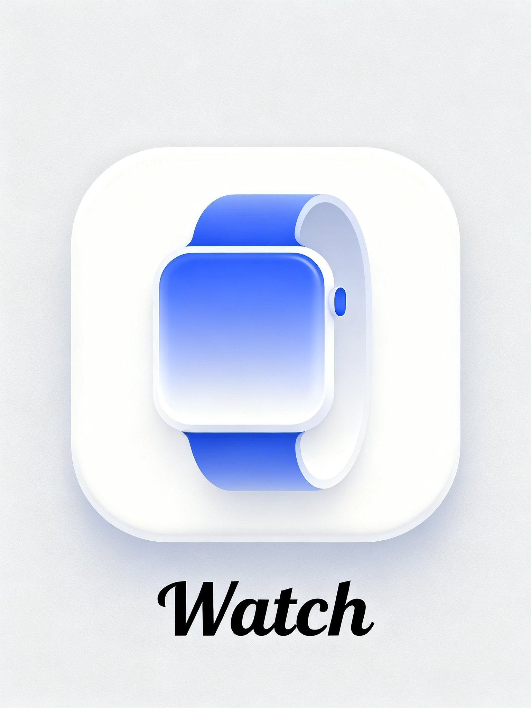

## 参考风格生成应用图标

### 概述

Seedream 4 做应用图标也不错啊，UI 这块终于有可以跟4o掰手腕得了

来源：[X 原帖](https://x.com/op7418/status/1965407894335373407)

### 适配模型

- Seedream 4.0

### 示例




### 提示词

```
参考图片的图标风格，帮我生成一个智能手表应用的图标，图标下方用艺术字体英文写着“Watch”
```
