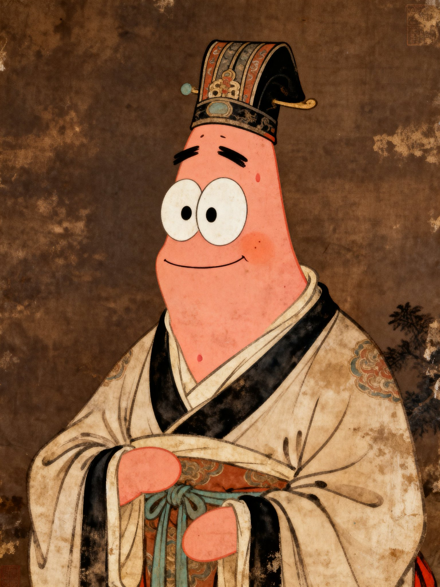
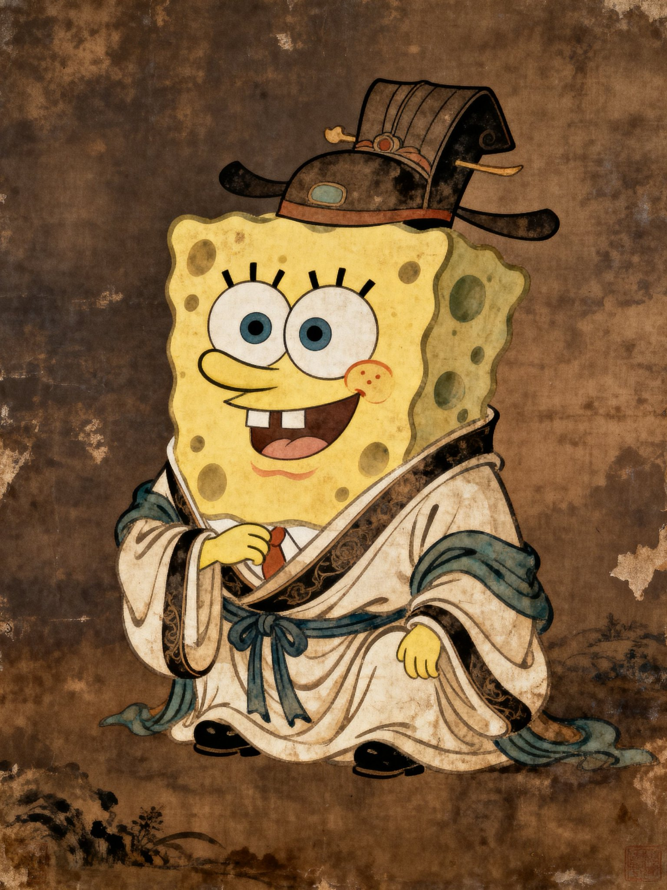

## 古装派大星工笔油画

### 概述

哈哈哈哈，身穿古代服饰的派大星和海绵宝宝

以前有 UP 就经常画这种，没想到现在即梦也能画了

来源：[X 原帖](https://x.com/op7418/status/1980296606382780794)

### 适配模型

- 即梦

### 示例




### 提示词

```
身上穿着唐朝服饰的一只派大星，自然逼真，北宋时期风格油画暗棕褐色旧版图高清，精细工笔，精细流畅、柔韧有力、充满韵律感。衣纹的勾勒，疏密有致。用色典雅，善于运用对比色，丰富和谐，头戴唐朝帽子，
```
