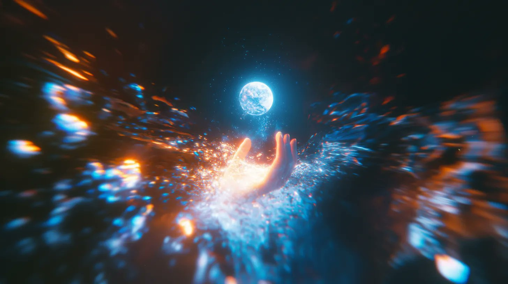

## 周刊封面：掌中星河

### 概述

这周的周刊封面，

来源：[X 原帖](https://x.com/op7418/status/1878489007283446013)

### 适配模型

- Midjourney v6.1

### 示例



### 提示词

```
Artistic conception, color grain, color curves, Chen Jialing, night glow, neon colors, close-up, a giant hand holding the moon and cosmic galaxy, stars flowing like sand through fingers emitting light, dew, self-luminous, flowing lines, master composition, ultra-dreamy colors --ar 16:9 --style raw --profile 2tnwgwe --stylize 50 --v 6.1
```
