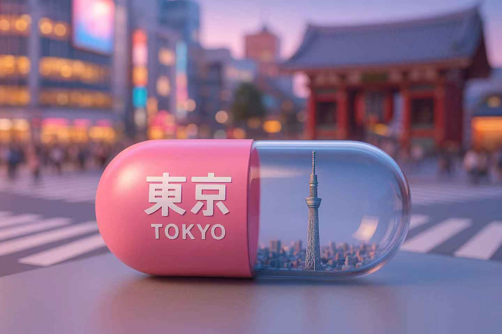

## 地区胶囊

### 概述

发现胶囊玩法又升级

来源：[X 原帖](https://x.com/op7418/status/1917179126450163895)

### 适配模型

- GPT-4o

### 示例





### 提示词

```
生成3:2 比例的图片，一个胶囊形状的创意微缩场景，胶囊横放着。胶囊一半为活力的樱花粉色或现代的银灰色，印有白色的字“東京”和英文“TOKYO”。另一半透明，展示东京真实的特色建筑缩影——一座现代的东京塔或晴空塔微缩模型，完全包含在胶囊里面，不超出边界。背景为繁华的涩谷十字路口或浅草寺的微缩景象，整体风格3D渲染，具有梦幻感，使用 C4D制作，材质有光泽感。
```
