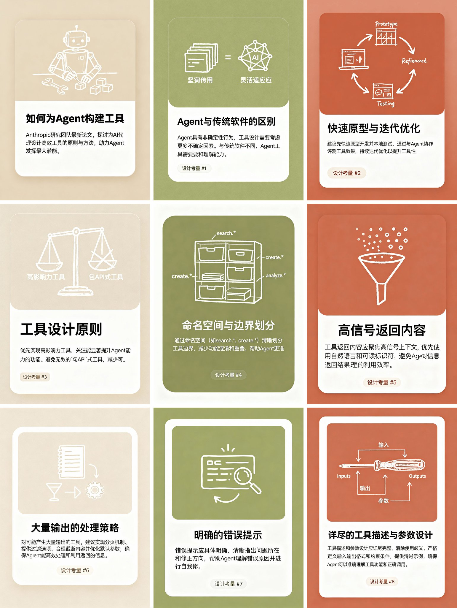

## 垫图自定义风格图文卡片

### 概述

发散了一下，你现在只需要垫一张图就可以让他生成任何风格的图文卡片！

这里转化了一下昨天 Anthropic 的 Agent 工具构建原则文档转化的图文卡片

我加了一张他们网页的截图，图文卡片就变成了 Anthropic 的设计风格

来源：[X 原帖](https://x.com/op7418/status/1966746933386768790)

### 适配模型

- Seedream 4.0（Lovart）

### 示例



### 提示词

```
帮我基于下面论文的介绍调用 seedream4.0 生成多张中文信息图 3:4卡片，第一张卡片需要有一个醒目的标题和文章主题简短介绍，其他卡片分别介绍论文的每个部分，卡片配图风格参考上传的图片。  具体的论文内容为：

垫图是这张
```
