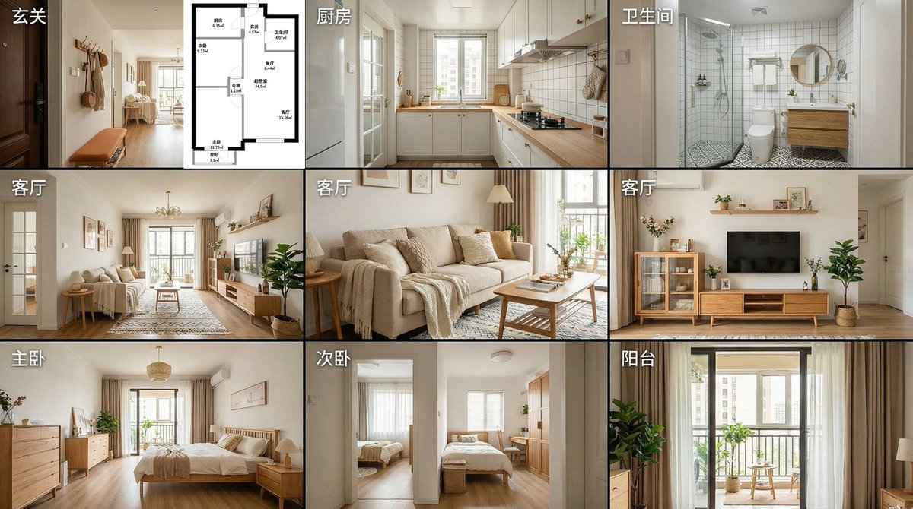

## 家装九宫格分镜

### 概述

先拿着户型图去找大香蕉（Nano Banana Pro）生成九宫格分镜，生成之后再把户型图和分镜图一起发给 Seedance 2.0 生成样板间参观视频。

来源：[X 原帖](https://x.com/op7418/status/2022721414462374031)

### 适配模型

- Nano Banana Pro

### 示例



### 提示词

```
基于当前的户型图，为我设计一套九宫格的样板间参观视频分镜图。
分镜图需要严格遵循以下顺序，所有的照片都从门口的玄关进入，依托于这个坐标点拍摄。
从玄关看向右手的厨房，看向左手的卫生间，再到客厅，最后到主卧和次卧
它的空间关系要跟这个户型图对应哈，风格得是这种温馨的北欧风格。
```
