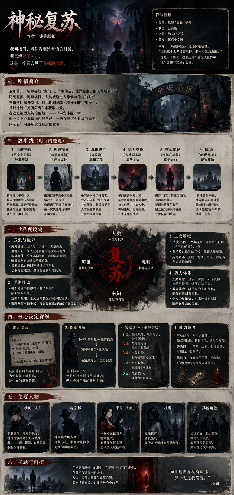

## 小说剧情世界观介绍长图

### 概述

只需要一句话，就能让 GPT 生成整篇小说的剧情和世界观介绍长图。我这里生成的是《神秘复苏》，换成你喜欢的小说名就行。

来源：[X 原帖](https://x.com/op7418/status/2046578883475243176)

### 适配模型

- GPT-Image-2

### 示例

### 提示词

帮我用一张长图详细地介绍《神秘复苏》这个小说的剧情、故事线和世界观。
