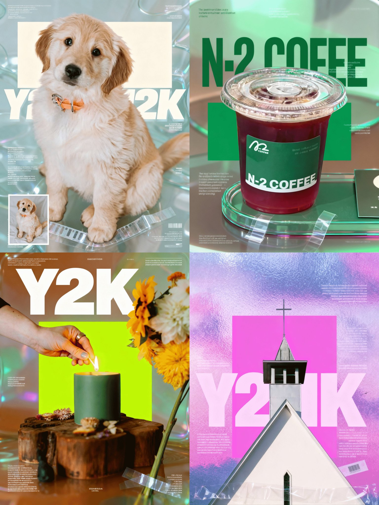

## 废片变 Y2K 酸性设计海报

### 概述

太好玩了！

拯救废片，将任何照片变成酸性设计海报的提示词

突发奇想能不能让 Seedream 4.0 帮我们把日常拍摄的废片用排版处理拯救一下

于是我真分析了一些常见的海报设计方法，把这些方法整理成提示词，果然可以将任何照片转换成Y2K 酸性设计的海报

来源：[X 原帖](https://x.com/op7418/status/1967529049888354557)

### 适配模型

- Seedream 4.0

### 示例



### 提示词

```
提示词在这里：

请分析我上传的这张照片，并将其转换成一张现代风格的平面设计海报。请按以下步骤操作：

主体处理：首先，将主体从原始背景中精确地抠出来，作为海报的核心主体。

背景改造：将原始背景替换为一个抽象的、具有毛玻璃质感的背景。这个新背景应该保留原背景的色调倾向（比如绿色和棕色），但要完全模糊掉具体细节。

核心构图：

在主体的后面，添加一个醒目的纯色矩形色块。色块的颜色请从照片上最亮的颜色中提取。

添加与照片主体内容相关的主标题文字，使用一种粗大的、有设计感的无衬线字体。最关键的是，将这个标题图层放置在主体的后面，形成主体遮挡文字的空间感。

细节添加：

在画面的不同位置，添加一些与画面内容相关的小号的、信息性的文字，以创造视觉层次。

在花茎的底部，添加一些模拟透明胶带的素材，让花朵看起来像是被贴在海报上一样，增加真实感和拼贴感。

风格统一：最后，确保整个海报的风格是Y2K美学或酸性设计，画面具有丰富的纹理和层次感。让标题和色块与背景的玻璃质感有一些透明度的融合，使整体看起来更协调。
```
