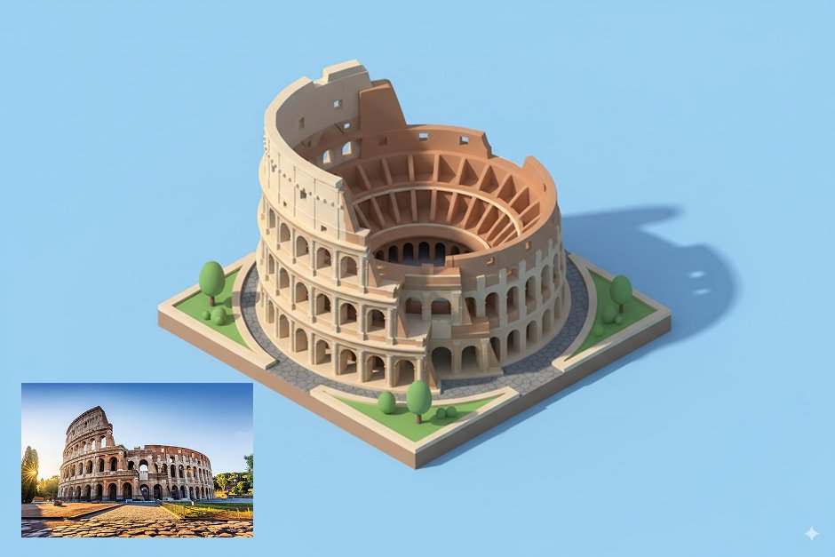
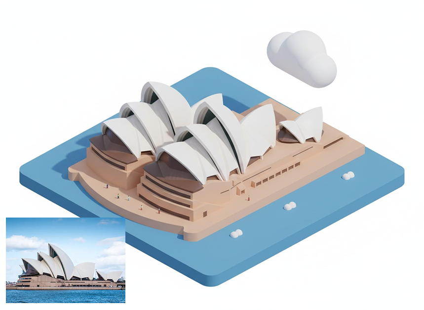
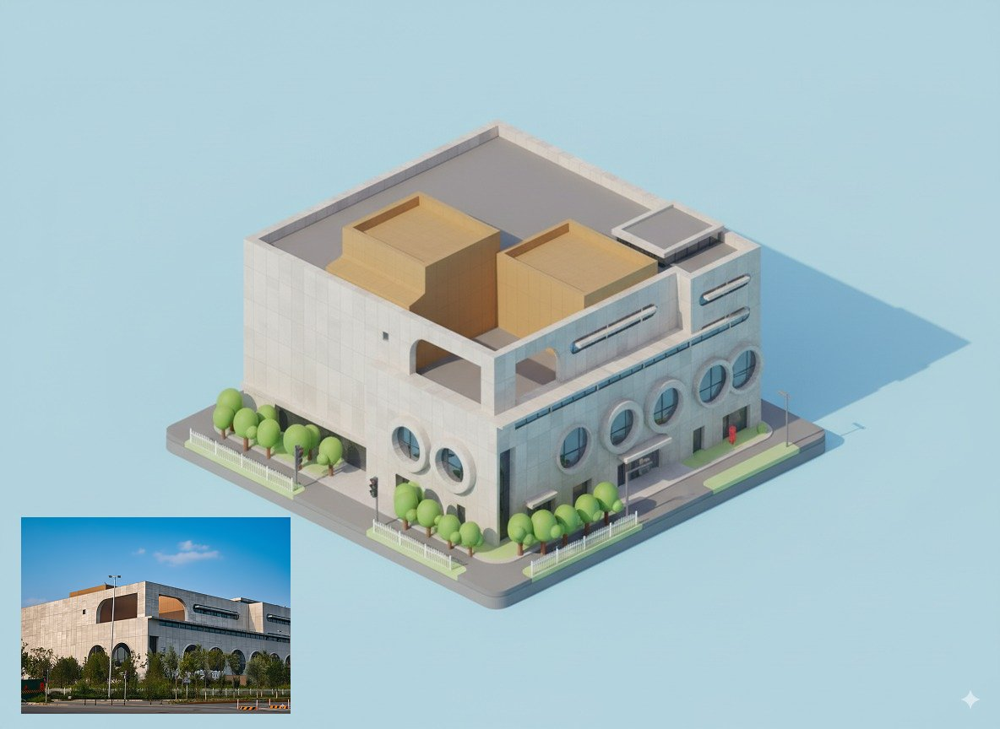
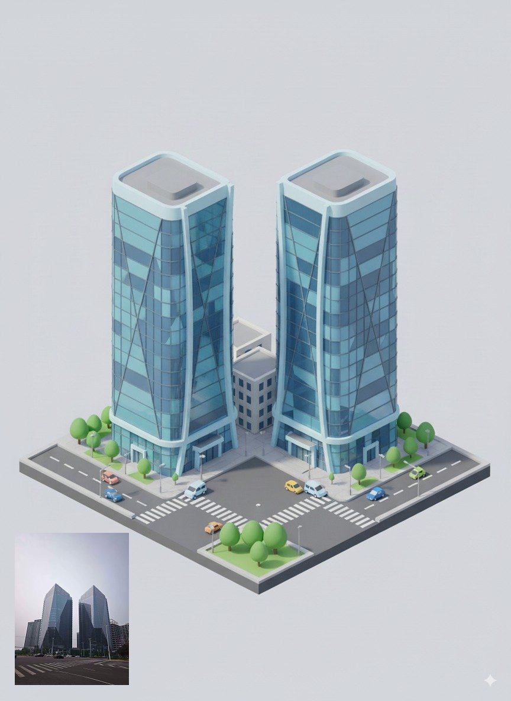

## 建筑照片转等距图标

### 概述

Nano Banana 当然也可以把建筑转成等距风格的图标

不同的是他不止可以转地标，你随手拍的任何建筑都可以转换

来源：[X 原帖](https://x.com/op7418/status/1961485790124359819)

### 适配模型

- Nano Banana

### 示例






### 提示词

```
Convert the photo of this building into a rounded, cute isometric tile 3D rendering style, with a 1:1 ratio,To preserve the prominent features of the photographed building
```
