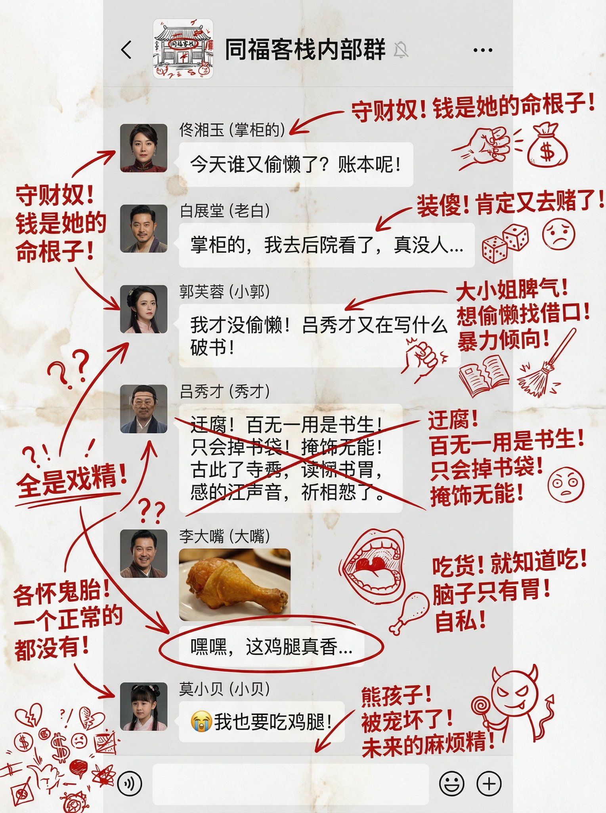

## 影视剧群聊截图红墨水批注

### 概述

群里朋友的想法，生成虚拟的影视剧聊天记录批注

搞了一个武林外传的群截图，哈哈

来源：[X 原帖](https://x.com/op7418/status/1998239514029064249)

### 适配模型

- Nano Banana Pro

### 示例



### 提示词

```
生成图片，一个虚拟的《武林外传》各个角色都在的微信群的聊天记录图片，他们的真实角色头像照片。

用符合他们人物性格和背景的对话内容填充，。用红墨水疯狂地在聊天记录加上手写中文批注、涂鸦、乱画，如果你想的话，还可以加点小剪贴画。

涂鸦内容主要是分析每个角色的潜在意图和他们真实的想法，需要语言犀利
```
