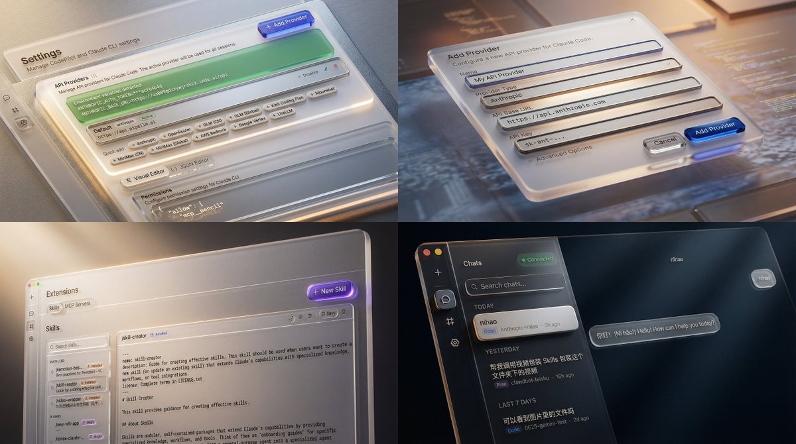

## 微软 Fluent 风 UI 包装

### 概述

把你随手截图的软件界面变成高大上的类似 3D 渲染微软或者苹果风格产品宣传片。我们需要先将 UI 截图和提示词发给 Nano Banana Pro 或者 Seedream 图像模型对截图进行处理，再将单张或者多张图片发给 Seedance 2.0 进行处理。

来源：[X 原帖](https://x.com/op7418/status/2022721414462374031)

### 适配模型

- Nano Banana Pro
- Seedream

### 示例



### 提示词

```
为这张 UI 设计稿添加类似于微软 UI 宣传片的包装，不要丢失原有内容，具体要求为一种“数字材质感”。他们不再把屏幕看作一张纸（像 Material Design 那样），而是看作一个有深度、有光影的三维空间。
光感 (Light): 光不仅仅是照明，更是引导。视频中常利用点光源、边缘光（Rim Light）来勾勒物体的轮廓，制造焦点。
材质 (Material): 这是最显著的特征。他们大量使用亚克力 (Acrylic) 材质——即带有磨砂玻璃质感的半透明效果，以及类似陶土、金属和硅胶的物理材质感。
深度 (Depth): 强调 Z 轴的概念。UI 元素不是平铺的，而是分层的，通过阴影和视差滚动来体现层级关系。2. 视觉表现特点：微距与质感 (Macro & Tactility)
这些宣传片最迷人的地方在于它们把 UI 图标当成了实体工业产品来拍摄。
极度微距摄影视角: 镜头往往贴得非常近，让你看到图标边缘的倒角、材质表面的细微颗粒（Noise）。这种“微距美学”让虚拟的软件界面产生了真实的触摸欲望。
完美的 CMF 设计: 借鉴工业设计中的 CMF（颜色、材质、表面处理），每个图标仿佛都是精心打磨的工艺品。例如 Word 的蓝色不再只是一个色块，而是一块有厚度、有光泽的蓝色类玻璃物体。
光线追踪渲染: 视频呈现出极高水准的渲染质量，特别是通过半透明材质（磨砂玻璃）透出来的漫射光，营造出一种高级、温润的氛围。
```
