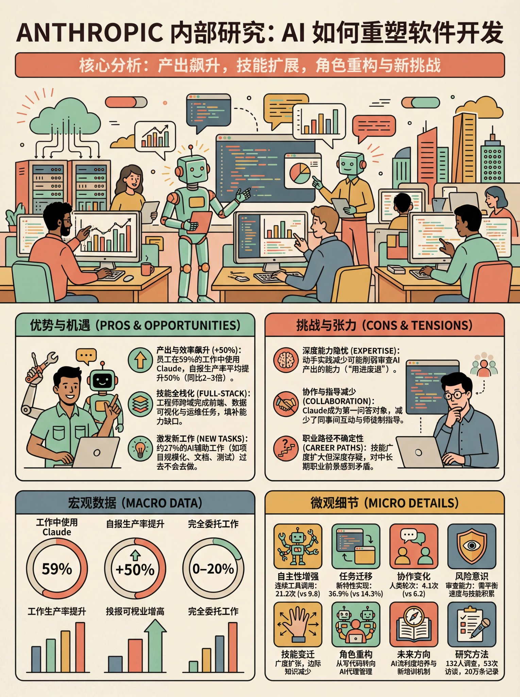

## 扁平插画社论风信息图

### 概述

🍌 Nano Banana Pro 扁平插画信息图提示词

转换的内容是 Anthropic 对于自己公司内部 Claude Code 使用使用情况的数据报告

这个提示词会帮你生成带有顶部矢量插图的详细信息图，所有数据和信息都会尽量用插画可视化表示

信息量很大，推荐使用 4K 分辨率生成

来源：[X 原帖](https://x.com/op7418/status/1998003256975618372)

### 适配模型

- Nano Banana Pro

### 示例



### 提示词

```
## 角色与任务

设计一张高质量、垂直构图的社论风格（Editorial Style）信息图。
目标： 通过视觉化的方式总结该主题的核心数据、对比信息和关键属性。

## 视觉风格与美术指导 (Visual Style & Art Direction)

- 插画风格： 扁平化矢量插画（Flat Vector Illustration）。必须包含清晰、统一粗细的黑色轮廓线（Monoline/Stroke）。色彩填涂需简洁，仅使用少量阴影，严禁使用渐变色或3D渲染效果。
- 构图形式： 横向全景式构图（Panoramic），占据版面顶部 1/3 的空间。
- 线条风格 (Line Work)： 必须使用统一粗细的黑色单线描边（Monoline/Uniform Stroke）。所有物体（建筑、植物、云朵）都必须有封闭的黑色轮廓，类似填色书的线稿风格。线条末端圆润，避免尖锐的棱角。
- 几何化处理 (Geometric Simplification)： 将复杂的物体简化为基本几何形状。例如，树木简化为棒棒糖形状或三角形，建筑物简化为简单的矩形块面，窗户简化为整齐的小方格网格。不要追求写实细节，要追求“玩具模型”般的可爱感。
- 空间与透视： 采用平视或稍微俯视的 2.5D 视角（类似等轴测，但更自由）。通过图层的前后遮挡来表现纵深，不要使用大气透视（即远景不要变模糊或变淡），所有图层清晰度一致。
- 装饰元素： 在空白处添加装饰性的几何元素，如放射状的线条（代表阳光或能量）、药丸形状的云朵、或者是简单的小圆点和星星，以平衡画面的视觉密度。
- 配色方案： 复古且柔和的色调。 
  - 背景： 米色/奶油色（Cream/Off-white）纸张纹理感底色。
  - 强调色： 珊瑚红、薄荷绿、芥末黄、赭石色（Burnt Orange）和岩石蓝。
- 字体排版： 
  - 主标题： 巨大的、加粗的复古衬线体（Retro Serif），体现权威感与优雅感。
  - 副标题： 位于矩形色块内的全大写无衬线体。
  - 正文： 清晰易读的几何感无衬线体。

## 布局与构图结构 (Layout Structure)

1. 顶部：视觉锚点 (The Header)
- 排版： 左上角放置引题（如 "关于...的一切" 或 "核心分析..."），右上角放置巨大的主题名称（[主题名]）。
- Hero Illustration（主视觉图）： 绘制一幅横跨版面的全景插画，展示 [主题] 的核心场景或外观。风格为几何化、带描边的扁平风格。
1. 中部：对比与细分 (The Split Section)
- 结构： 将画面横向分割为两个模块（或上下两层）。
- 内容： 用于对比两个子主题（例如：型号A vs 型号B，优点 vs 缺点，过去 vs 现在）。
- 元素： 每个模块需包含一个代表性的插画建筑或物体，并附带关键参数的文本框（如价格、尺寸、核心功能）。
1. 底部：数据可视化网格 (Data & Metrics)
- 左侧（宏观数据）： 垂直排列的圆形图标/仪表盘。使用圆环图展示百分比数据（如：增长率、满意度、占比），并用大号字体标注数值。
- 右侧（微观细节）： 密集但整齐的网格布局。使用可爱的小型矢量图标（带描边）代表具体项目（如：组件、配件、单项成本）。每个图标旁需紧跟具体的数值或简短说明。

## 内容生成要求

- 根据 [主题] 检索并整理真实或合理的详细数据。
- 确保所有文字清晰可读，严格遵循视觉层级（标题 > 副标题 > 正文）。
- 使用粗黑线条明确区分不同的内容板块。

## 需要生成的内容为：
```
