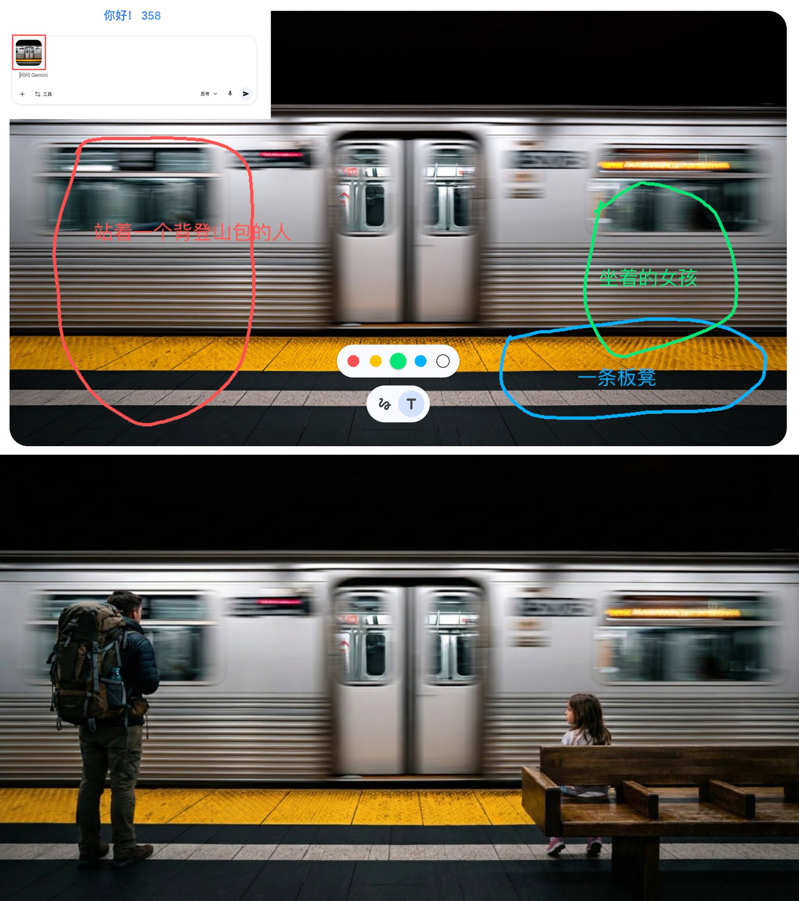

## 按标记精准修改图片

### 概述

Gemini 更新了一个相当牛逼的功能！

上传图片的时候可以添加标记了，用 Nano Banana Pro 精准编辑图片。

控制你需要添加或者修改的物体的位置以及物体内容

上传图片后点击上传图片即可添加。

来源：[X 原帖](https://x.com/op7418/status/2000856779102777411)

### 适配模型

- Nano Banana Pro

### 示例



### 提示词

```
按照图片上的标记对图片进行修改，修改完成后将标记去掉，包括文字和画线
```
