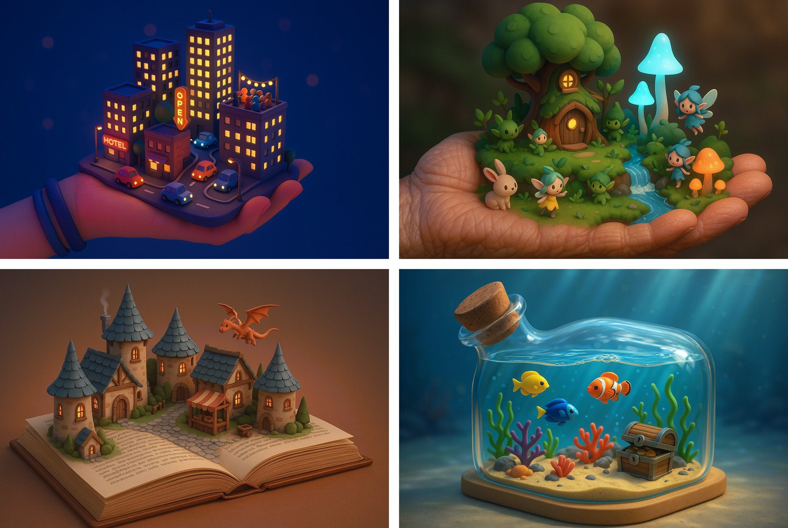

## 掌心微缩景观

### 概述

4o 生成的掌上微缩景观

来源：[X 原帖](https://x.com/op7418/status/1910607073118769460)

### 适配模型

- GPT-4o

### 示例



### 提示词

```
一个3D可爱小型可视化场景，描绘了一个生机勃勃的奇幻森林：里面有发光的小蘑菇、潺潺的迷你溪流、古怪的树屋，还有几只迷你的小精灵和小动物在探索。整个场景呈现在一位老者布满皱纹的掌心之上。
```
