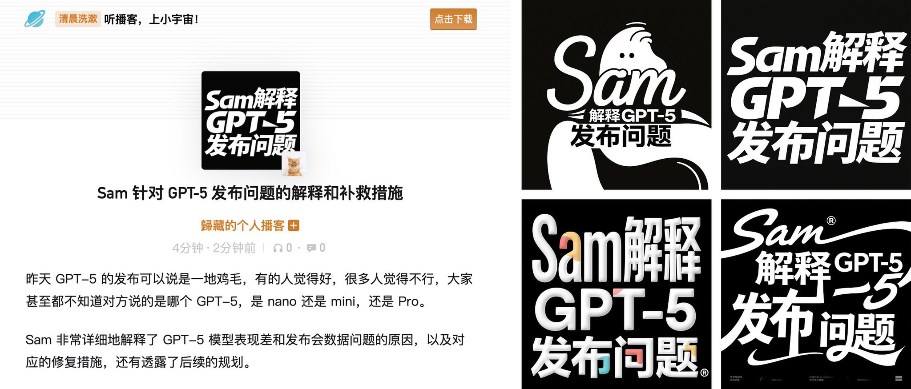

## 播客单集封面字体设计

### 概述

最近开了一个小宇宙播客

用 ListenHub 新上的 FlowSpeech 能力生成单人的播客发一些消息和自己的思考,但是单集播客封面很麻烦。

分享一个小技巧，可以用即梦的字体提示词直接生成单集播客封面，效果非常好

来源：[X 原帖](https://x.com/op7418/status/1954014383564370333)

### 适配模型

- 即梦

### 示例



### 提示词

```
提示词，换掉引号里的文字就行：

黑色背景，白色字，创意字体设计，流畅且富有艺术感，“Sam解释 GPT-5 发布问题”，设计灵感：将字体进行抽象变形，给人以强烈的视觉冲击。最后一个字着重表现，高级感，扁平化，大师作品。
```
