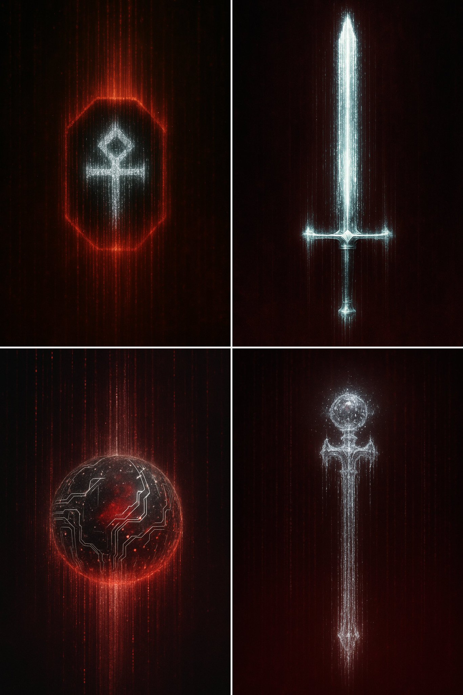

## 数据流代码器物

### 概述

发现了一个很炫的 4o 图片风格提示词

可以生成类似数据流代码的器物图片，给人一种高科技和复古结合的感觉，于是整了一套数据流装备

来源：[X 原帖](https://x.com/op7418/status/1930538219894145331)

### 适配模型

- GPT-4o

### 示例



### 提示词

```
代码之剑（Excalibur Machina），其剑刃完全由凝固的光芒、倾泻而下的数字粒子和故障般的垂直数据流构成，漂浮在幽暗的深红色环境中。剑刃的边缘及剑柄消融成垂直的光痕和数据粒子，仿佛正在从代码中解体或形成。

剑柄呈现出冰冷、具有未来感的冰白色与银色金属质感。整体纹理具有高对比度，冰白色和银色在柔和的红黑色背景下尤为突出。光照具有电影感和氛围感，营造出神秘与力量的气息。

灵感来源于赛博朋克美学和《黑客帝国》式的代码雨，但带有一种纯净、具有未来感的扭曲。抽象，却又富有结构。没有锐利的线条——一切都伴随着数字伪影、噪点轨迹和故障纹理而流动。
```
