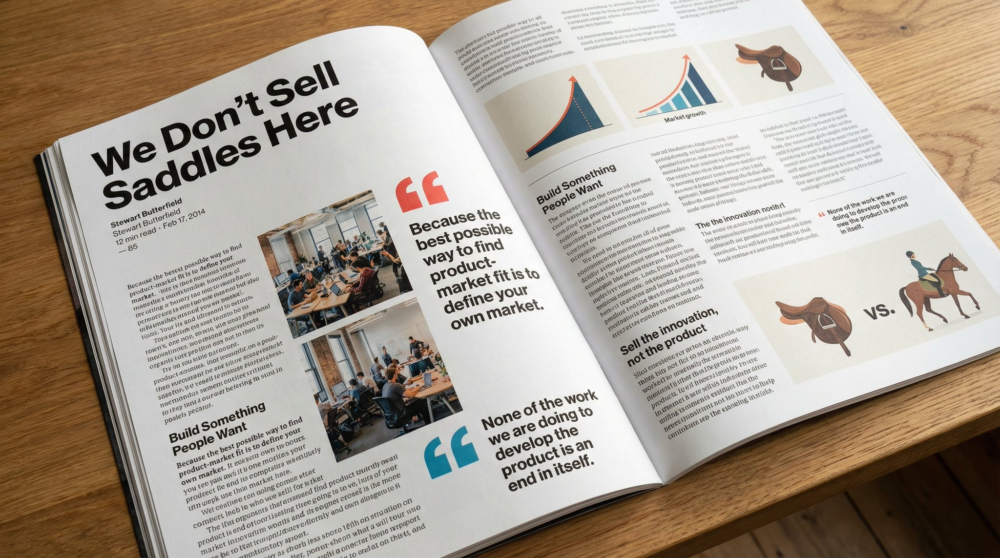

## 整篇文章排版成杂志页

### 概述

🐂🍺，Nano Banana Pro 直接将一整篇文章排版成杂志。

来源：[X 原帖](https://x.com/op7418/status/1991702565579563166)

### 适配模型

- Nano Banana Pro

### 示例



### 提示词

```
请将这段文字原封不动地复制到一张精美杂志文章的照片中，照片需包含图片、漂亮的排版设计、精选语录和大胆的格式。原文如下：
```
