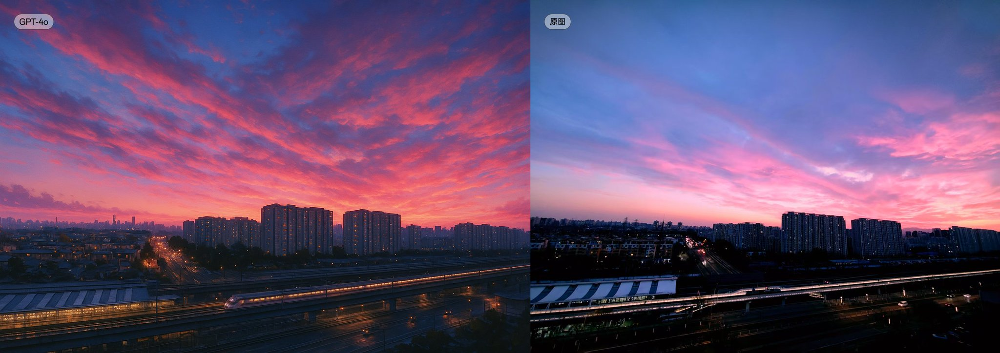

## 新海诚风城市照片

### 概述

新海诚的这种画风转换城市摄影效果真的很好

方法昨天一些朋友也说了，就是只描述画风但是不提人名

一个小Tips是可以让Gemini 2.5 Pro描述，别让ChatGPT描述，不然还是有几率不给生成

来源：[X 原帖](https://x.com/op7418/status/1906202138549555334)

### 适配模型

- GPT-4o

### 示例



### 提示词

```
生成3:2图片，将我的照片转换为下面这种动画风格：

1. 极致写实的背景与环境细节：

照片级精度： 场景描绘达到了近乎照片的逼真度，但又并非简单的照片临摹，而是带有浓厚绘画感的再创作。每一个细节，从路牌上的文字、墙壁的纹理、金属的锈迹到柏油路面的颗粒感，都经过精心绘制。

“空气感”的营造： 画面极力表现光线穿过大气时的散射、尘埃在光束中的漂浮感，以及远景因大气透视而产生的微妙色彩和清晰度变化，营造出强烈的空间感和“空气感”。

平凡之物的诗意化： 对日常生活中随处可见的元素，如交错的电线杆与电线、繁忙的十字路口、老旧的自动贩卖机、车站的指示牌、公寓楼的阳台等，都赋予了极高的绘制精度和美学价值，使其在平凡中透出诗意。

2. 光影的魔法——情感与氛围的塑造者：

戏剧性的光效运用： 光线不仅仅是照明，更是情绪的画笔。标志性的**“耶稣光”（丁达尔效应）**频繁出现，光束穿透云层或窗户，营造神圣、希望或奇迹感。逆光的大量使用勾勒出人物或景物的轮廓，产生剪影效果，增强唯美和神秘感。
细腻的光影层次： 物体受光面、背光面、反光和投影都被细致描绘，层次丰富。尤其擅长表现水面、玻璃、湿润路面等对光线的复杂反射和折射，使画面充满流动感和光泽。
时间与情绪的色彩： 不同时段的光线被赋予特定色温和情感。清晨是清冷的蓝调带着微暖的曦光；午后是明亮耀眼的白光与清晰的阴影；黄昏是饱和度极高的暖橙、粉紫调，渲染出浓郁的浪漫或伤感；夜晚则是深邃的蓝与城市灯火（霓虹、车灯）的冷暖对比，营造繁华与孤独并存的氛围。
镜头效果模拟： 经常运用镜头光晕（Lens Flare），模拟摄像机镜头对着强光源时产生的炫光效果，增加画面的真实感和梦幻感。**景深（Depth of Field）**效果显著，通过模糊前景或背景来突出主体，引导观众视线，并产生电影般的视觉体验。

3. 高饱和度、高对比度的色彩哲学：

标志性的天空蓝： 天空往往呈现出一种异常清澈、饱和度极高的蓝色（有时是带有紫色倾向的蓝），云朵的体积感和光影变化被极致刻画，极具视觉冲击力。
鲜明而和谐的配色： 整体色彩饱和度偏高，对比强烈，但不俗艳。即使是描绘城市，也常常通过滤镜般的处理，让色彩更加鲜亮、纯净，带有一种理想化的美感。
细腻的色彩渐变： 天空、水面等大面积色块的处理上，色彩过渡极其平滑、细腻，层次丰富，展现出高超的数字绘画技巧。

4. 对自然现象的精妙捕捉：

雨与雪的诗篇： 雨滴的形态、速度、打在不同物体表面的飞溅效果；雪花的晶莹剔透、飘落的轨迹、积雪的松软质感，都被描绘得淋漓尽致，并常常作为推动情节、渲染情绪的重要视觉元素。
流动的云与风： 云的形态变幻万千，从薄如蝉翼的卷云到厚重如山的积雨云，其流动感和光影变化被生动捕捉。风吹动树叶、发丝、衣角的动态也描绘得十分细致。
星空的璀璨： 夜空中的繁星、银河、流星等天文景象，常常以超乎现实的清晰度和亮度呈现，营造出浩瀚、神秘与浪漫的氛围。

5. 写实背景与风格化人物的对比融合：

人物的简洁化： 相较于背景的极致精细，人物造型遵循典型的日式动画风格，线条相对简洁，面部特征（尤其是眼睛）被适度夸张以传递情感，但与环境融合自然，并未产生强烈的割裂感。这种对比反而更能凸显环境的宏大与人物情感的细腻。
```
