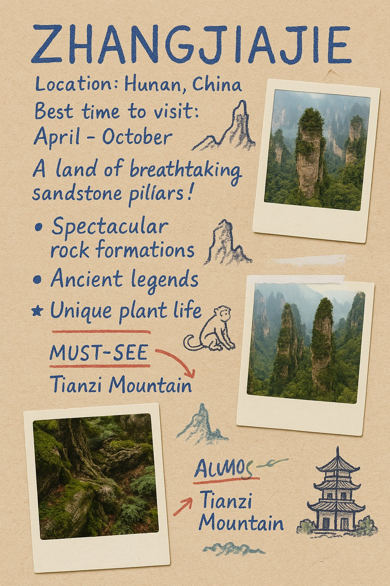
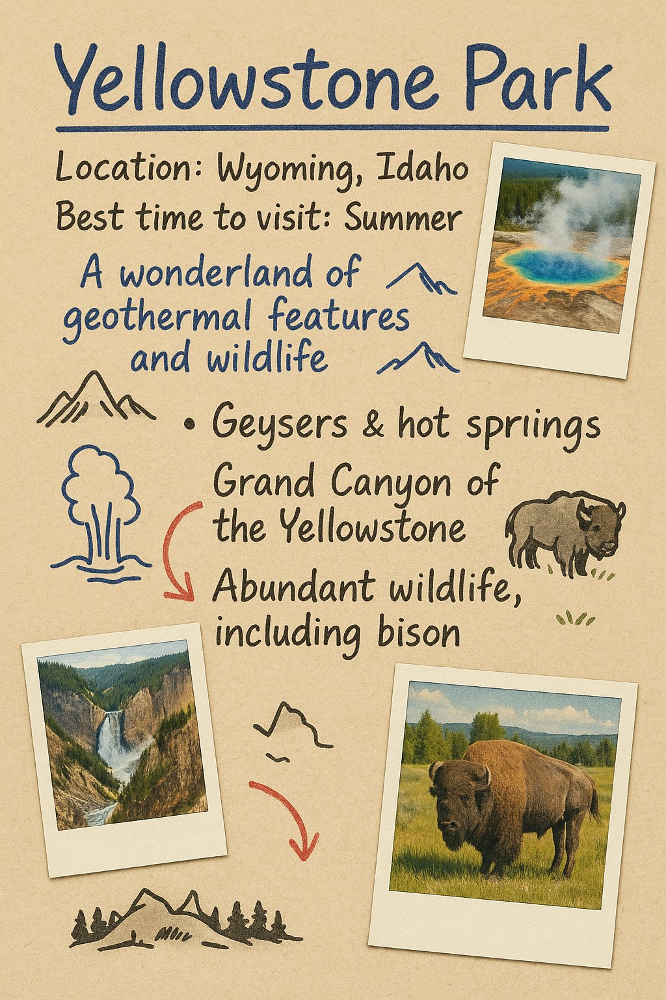

## 景区手写游览笔记

### 概述

用 4o 生成非常可爱的景区游览笔记

来源：[X 原帖](https://x.com/op7418/status/1907725315025330245)

### 适配模型

- GPT-4o

### 示例




### 提示词

```
请生成一张图片，模拟在一张略带纹理的纸张（比如米黄色或浅棕色）上手写的关于景区 [请在此处替换为景区名称] 的讲解笔记。图片应呈现旅行日志/拼贴画风格，包含以下元素：

用手写字体（比如蓝色或棕色墨水）书写景区名称、地理位置、最佳游览季节、以及一两句吸引人的标语或简介。
包含几个主要看点或特色的介绍，使用编号列表或项目符号（例如：[列举2-3个具体看点，如“奇特的岩石形态”，“古老的传说”，“独特的植物”等]），并配有简短的手写说明。
用红色笔迹或其他亮色圈出或用箭头指向特别推荐的地点或活动（例如 [列举1-2个推荐项]）。
穿插一些与景区特色相关的简单涂鸦式小图画（例如：[根据景区特色想1-2个代表性图画，如山峰轮廓、特色动植物、标志性建筑等]）。

点缀几张关于该景区的、看起来像是贴上去的小幅照片（可以是风景照、细节照，风格可以略显复古或像宝丽来照片）。 整体感觉要像一份由热情导游或资深游客精心制作的、生动有趣的个人导览手记。
```
