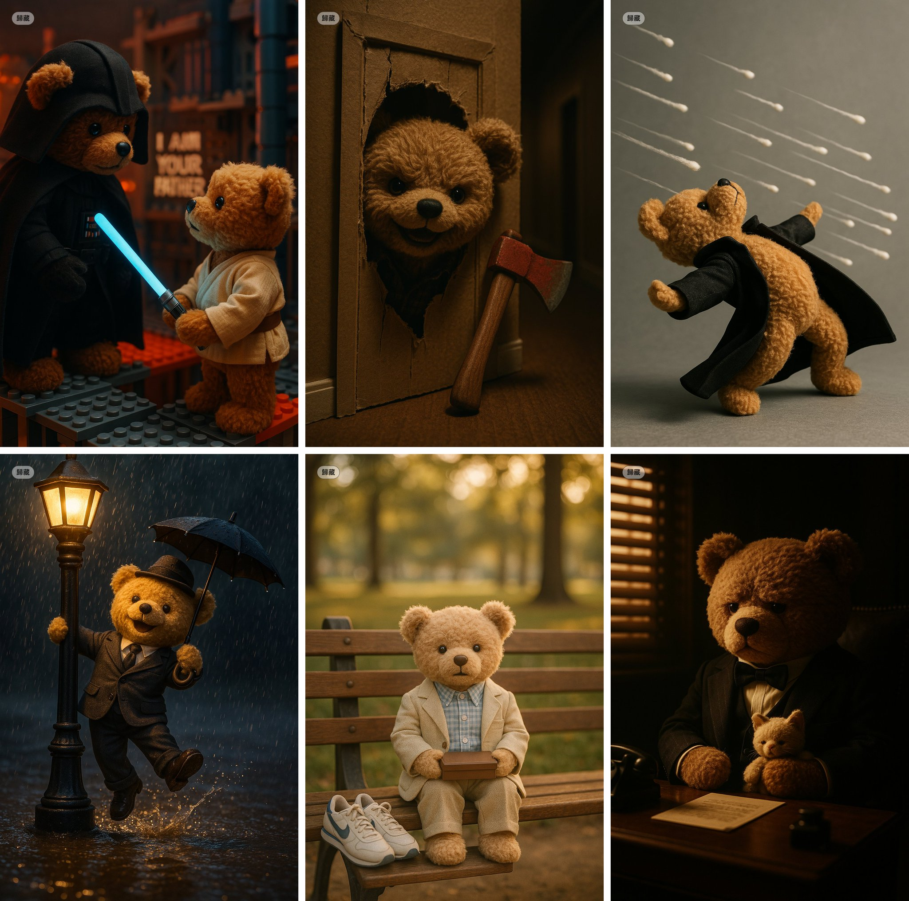

## 泰迪熊电影剧照

### 概述

太可爱啦，用4o做的非常萌的泰迪熊电影剧照

可以猜到这几张图分别是哪个电影吗

来源：[X 原帖](https://x.com/op7418/status/1908783026731175951)

### 适配模型

- GPT-4o

### 示例



### 提示词

```
一个充满氛围感的电影中近景镜头，戏仿《The Godfather》中 Don Vito Corleone 在他昏暗办公室里的经典场景。一只体型稍大的泰迪熊，穿着深色西装，威严地坐在一张迷你办公桌后面，爪子里可能抱着一只更小的毛绒玩具（模仿猫）。房间光线昏暗，运用强烈的明暗对比（chiaroscuro），营造出一种既有权力感、沉思感，又不失泰迪熊固有可爱的奇特融合。
```
