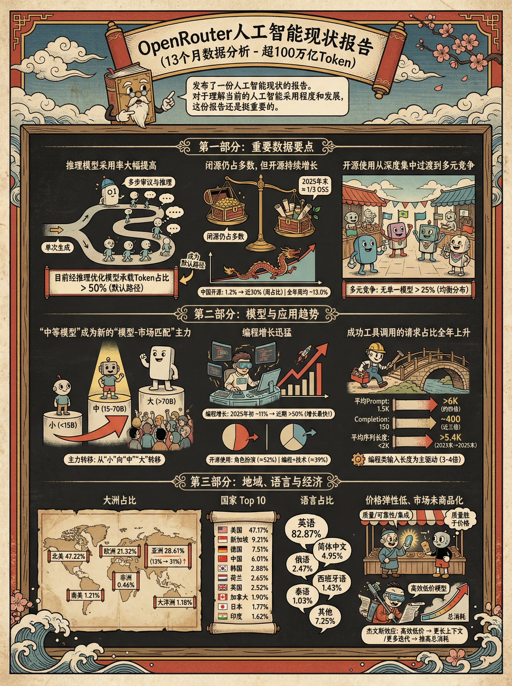

## 浮世绘茶杯头风信息图

### 概述

很多朋友要我这个 Nano Banana Pro 生成信息图的提示词

其实非常简单，跟他说：

“用浮世绘+茶杯头的风格为下面的内容生成信息图” 就可以了

来源：[X 原帖](https://x.com/op7418/status/1997283261064925190)

### 适配模型

- Nano Banana Pro

### 示例



### 提示词

```
用浮世绘+茶杯头的风格为下面的内容生成信息图
```
