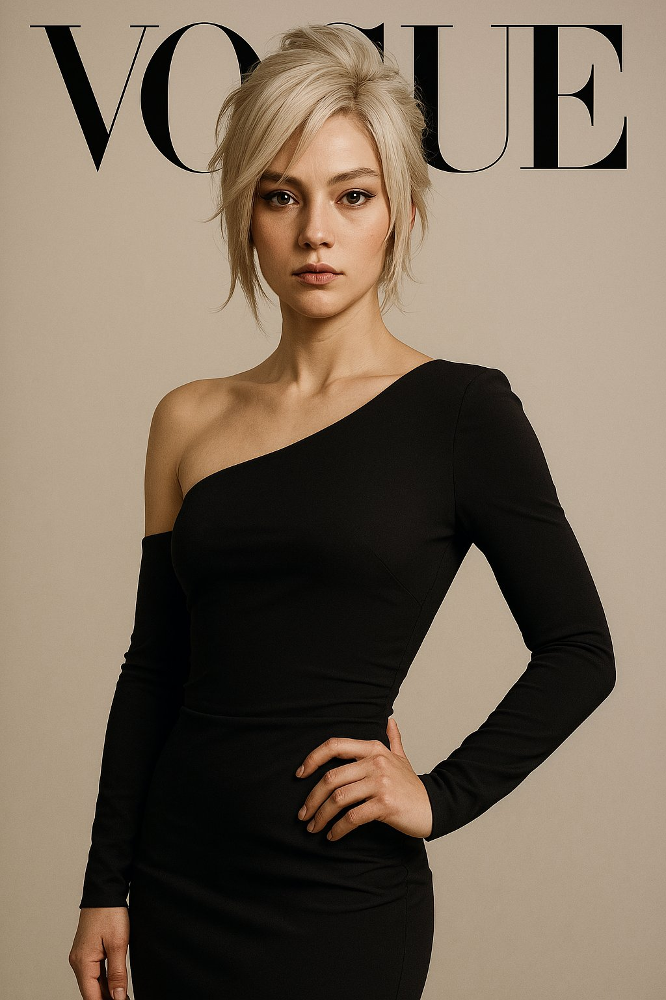
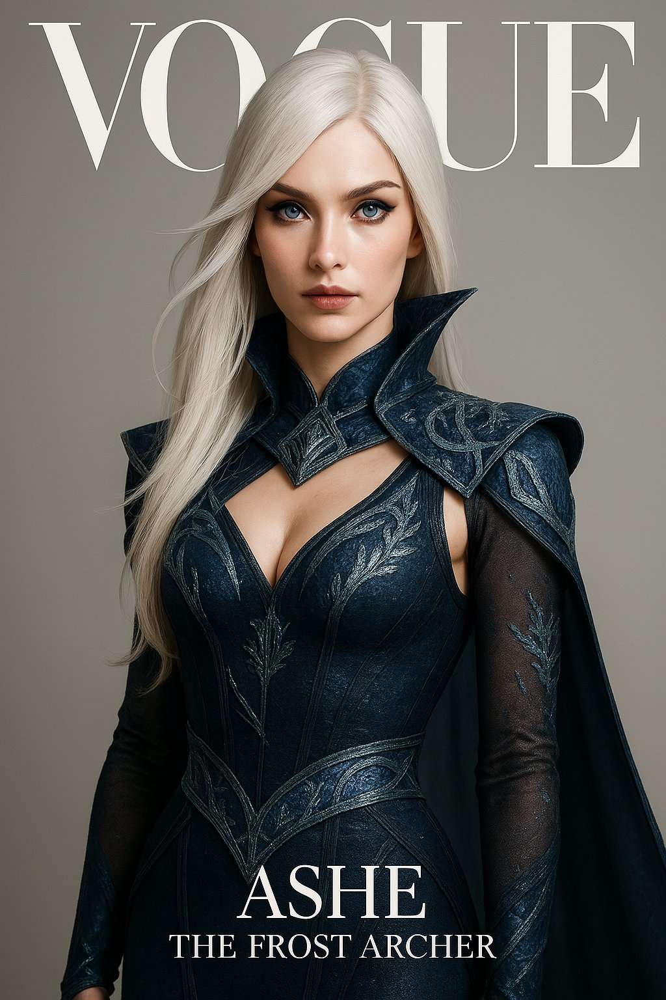

## 游戏角色时尚杂志封面

### 概述

给《英雄联盟》的锐雯和艾希整两张时尚杂志封面

来源：[X 原帖](https://x.com/op7418/status/1906959653667582068)

### 适配模型

- GPT-4o

### 示例




### 提示词

```
《VOGUE》杂志封面：来自 League of Legends 的 Ashe - The Frost Archer 化身为高级时装模特。写实肖像，突出她标志性的白色长发、锐利蓝眼和冰霜女王般的冷艳气质。简约背景，专业摄影，身着融合了冰霜元素和高级定制风格的优雅紧身服饰。
```
