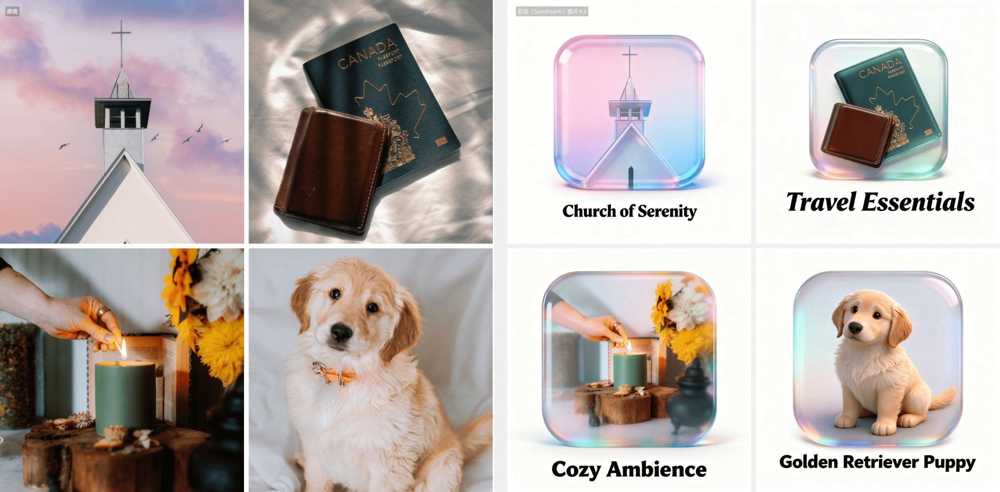

## 照片变磨砂玻璃图标

### 概述

豆包 Seedream 4.0 图片模型新活

照片变玻璃质感头像&图标，任何照片都行不需要改提示词

来源：[X 原帖](https://x.com/op7418/status/1964969827350839752)

### 适配模型

- Seedream 4.0

### 示例



### 提示词

```
将这张照片的景色变成一个带有照片相关渐变色，透明磨砂玻璃慢射材质，图标下方用有艺术黑体写着跟图片景色相关的英文标题，纯白背景的圆角矩形图标，C4D，OC渲染。
```
