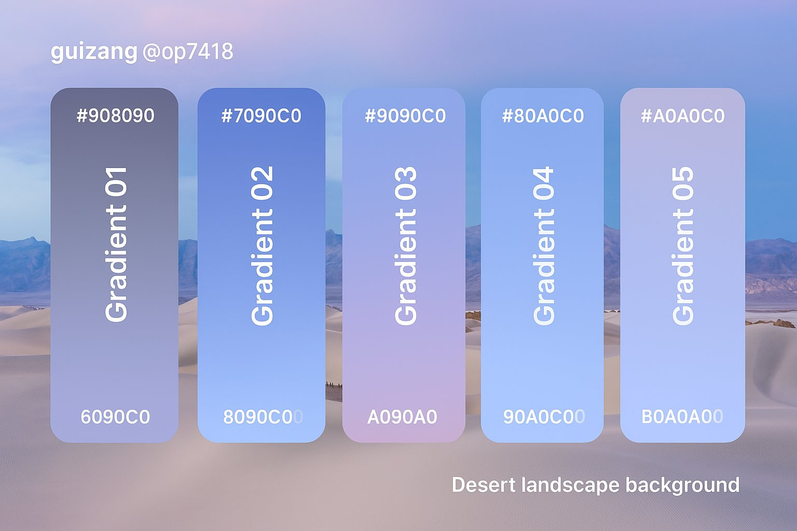
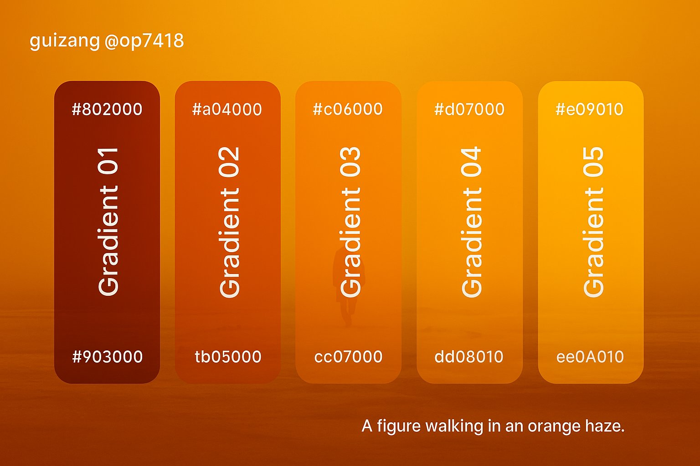
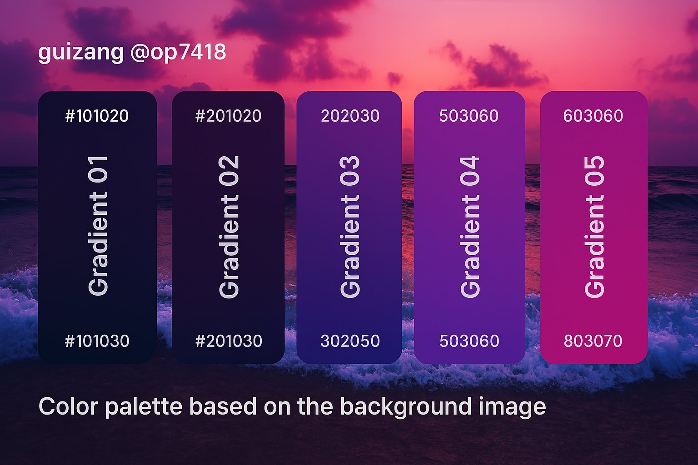
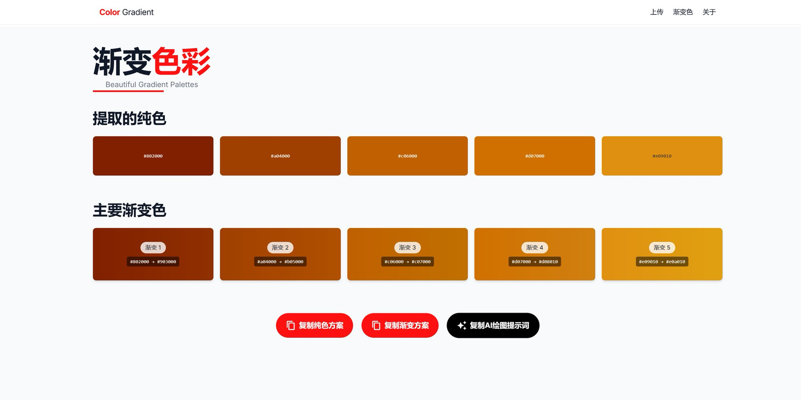

## 照片渐变色板

### 概述

GPT-4o 生成电影图片或者你拍摄照片的渐变色板图片

因为他直接生成获取的渐变色差太多

我还写了一个网页帮大家从图片获取渐变色和生成提示词

顺便规避对于版权内容的限制

来源：[X 原帖](https://x.com/op7418/status/1905888224129737147)

### 适配模型

- GPT-4o

### 示例






### 提示词

```
基于我上传的图片生成一张3:2的展示调色板的图片。画面包含5个并排水平排列的竖向圆角矩形色板。

每个色板展示一种独特的、平滑的垂直色彩渐变。在每个渐变色板的顶部和底部（或关键颜色点）清晰地显示相应的十六进制颜色代码（例如：# FBF5F0, # FBD5BD）。
在每个色板内部包含逆时针旋转90度的垂直文字标签，如"Gradient 01"、"Gradient 02"等。
背景设置为我上传的图片。

在左上角包含标题/创作者姓名的占位文字，内容为："guizang @ op7418"，底部有右对齐描述背景图片内容的文字。

整体美学风格应为干净、现代、专业、UI设计风格、图形设计情绪板。重点清晰呈现渐变效果和十六进制代码。

五组渐变色应该是：
```
