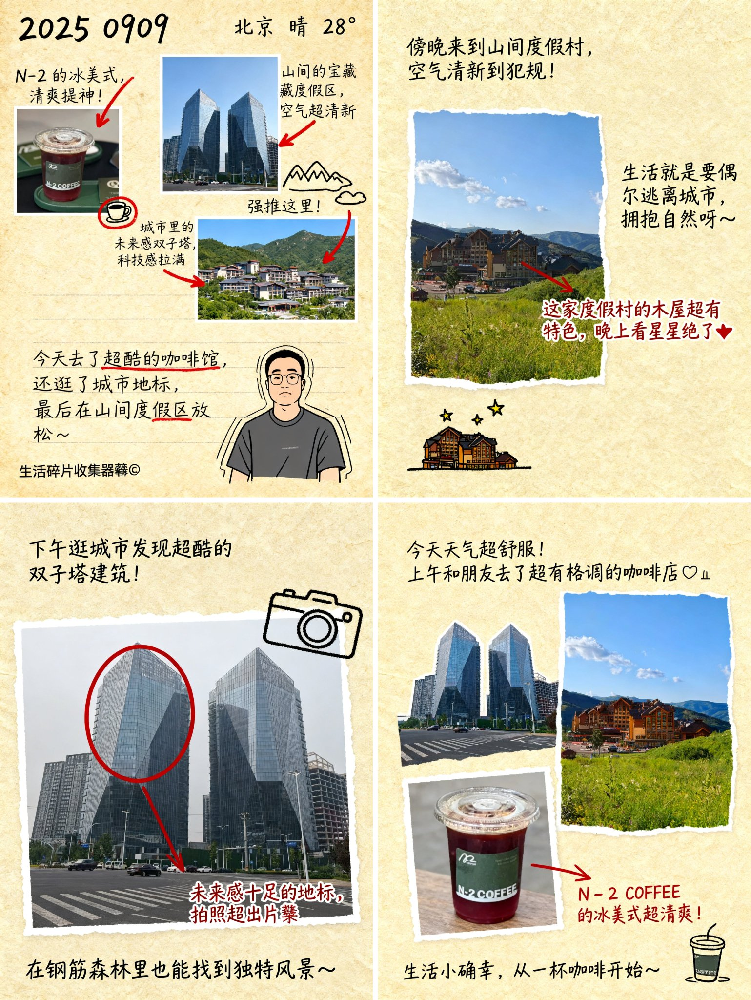

## 照片生成拼贴手账日记

### 概述

哈哈 昨晚跟 Jessy 聊天想到的想法，没想到真行！

上传你今天拍的照片豆包 Seedream 4.0 图片模型就会帮你生成拼贴画日记图片

完全不需要你自己写日记了编辑了，如果有自拍照的话还会帮你画一个简笔画

来源：[X 原帖](https://x.com/op7418/status/1965248939298574595)

### 适配模型

- Seedream 4.0

### 示例



### 提示词

```
帮我生成一张图片，根据图片内容帮我模拟在一张略带纹理的纸张上（米黄色或者浅棕色）手写的关于今天的日记。所有的图片以拼贴画风格放在一页日记上，包含以下元素：

用手写字体描述今天做了什么，以及一两句吸引人的标语或简介，包含几张图片的介绍，用红色笔迹或其他亮色圈出或用箭头指向特别推荐的地点或活动。穿插一些与图片特色相关的简单涂鸦式小图画，写着标题“2025 0909 ”“北京 晴 28°”，并添加一个图 4 角色的手绘形象。

整体感觉要像一份由热爱生活的作者精心制作的、生动有趣的个人日记。
```
