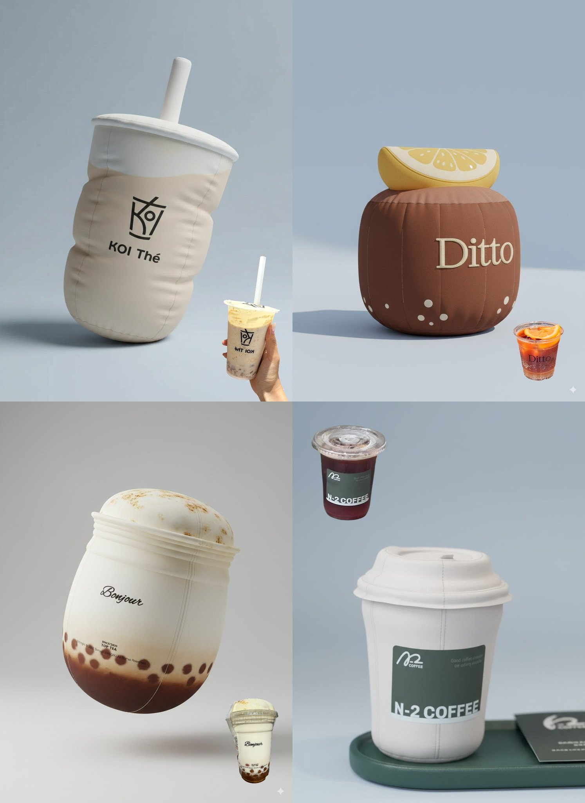

## 物品变充气抱枕

### 概述

用 Nano Banana 将你喜欢喝的饮品变成抱枕收藏起来！

不管是奶茶还是咖啡，还有其他你喜欢的物品，提示词是通用的 ，感觉都可以做个应用了

来源：[X 原帖](https://x.com/op7418/status/1961496316204462318)

### 适配模型

- Nano Banana

### 示例



### 提示词

```
Design the main object in the photo as a soft, rounded, and airy plush balloon or inflatable toy. 

Using smooth matte fabric texture, Do not have a plastic feeling. complemented by subtle fabric wrinkles and stitching to emphasize its inflated effect. The shape should be slightly irregular and soft, with gentle shadows and lighting to highlight its volume and realism. Place it on a clean, minimalist background (light gray or light blue) to maintain a playful sculptural aesthetic.
```
