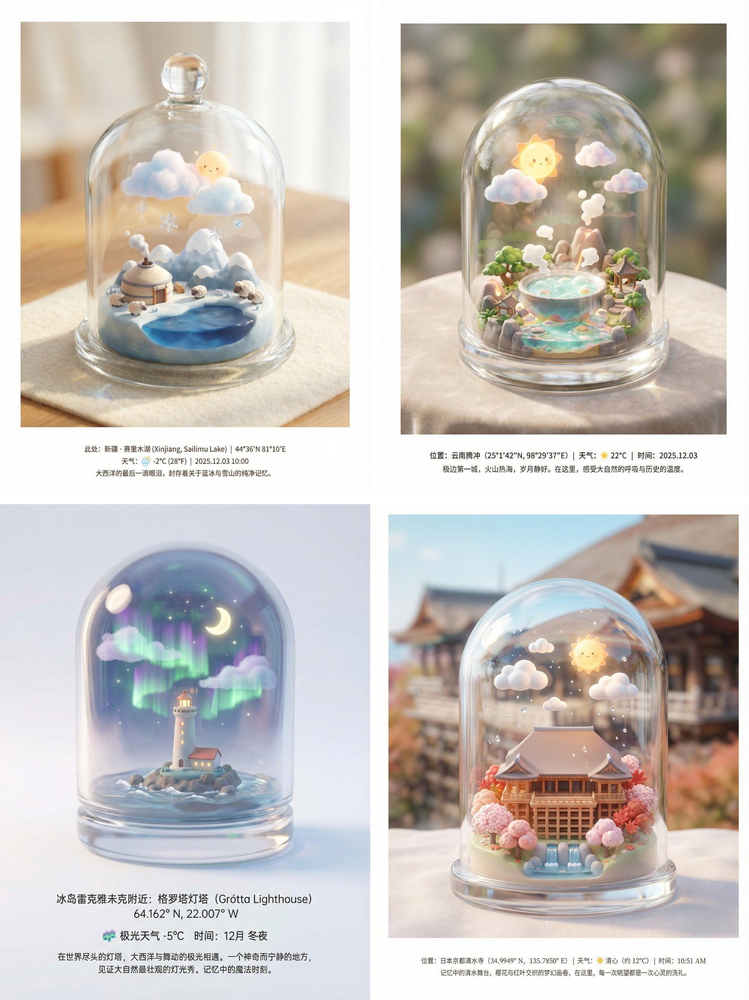

## 玻璃瓶微缩地点模型

来源：[X 原帖](https://x.com/op7418/status/1996037947964228011)

### 概述

很多人去过同一个景点，但你的体验是独一无二的。把地标装进瓶子里。

下方依旧有地点相关的文字介绍，你可以改成你自己的感想。

### 适配模型

- Nano Banana Pro
- Seedream

### 示例

### 提示词

海报设计、自媒体封面设计：查找 [在此处输入地点名称 或 经纬度坐标] 的标志性景观或建筑，并获取该地点在特定时间的天气状况。

画面的主体是一个极其精致、透亮且带有厚度感的玻璃罐子（类似于圆顶玻璃罩、标本罐或复古水晶球），稳稳地放置在一个干净、柔和的平面上。玻璃罐子内部，封存着该地点代表性景观的Q版微缩模型。模型材质呈现出高级的软润感（类似软陶或磨砂树脂），色彩治愈。在罐内景观的上方，悬浮着对应天气的微缩模型（例如：Q版棉花糖般的云朵、发光的小太阳、或几滴晶莹的雨滴）。

风格为梦工厂动画风格，3D建模，光线极为柔和梦幻。强调玻璃材质的真实感，光线透过玻璃罐产生漂亮的折射、反光和焦散效果，让内部的景物显得更加珍贵。采用强烈的移轴摄影镜头效果，焦点清晰地集中在玻璃罐内的微缩景观上，罐子外部和背景完全虚化模糊。

画面周围大面积留白，保持干净高级感。画面底部居中位置，使用无衬线体小字清晰标注：位置信息（地点名称及具体的经纬度）、天气图标及温度、时间，以及一段关于这个旅行地点的精简中文介绍文案（侧重于描述记忆或氛围）。高品质画面输出，细节丰富惊人。