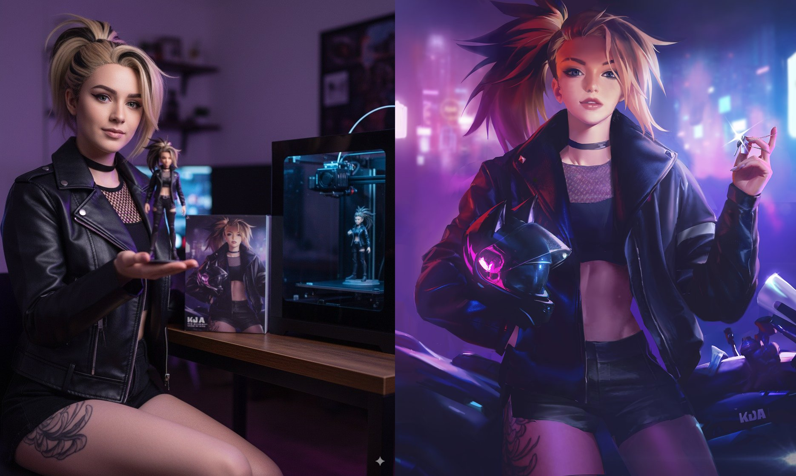
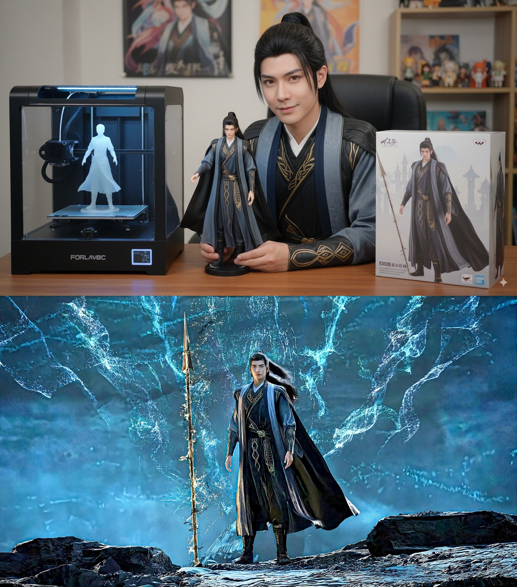
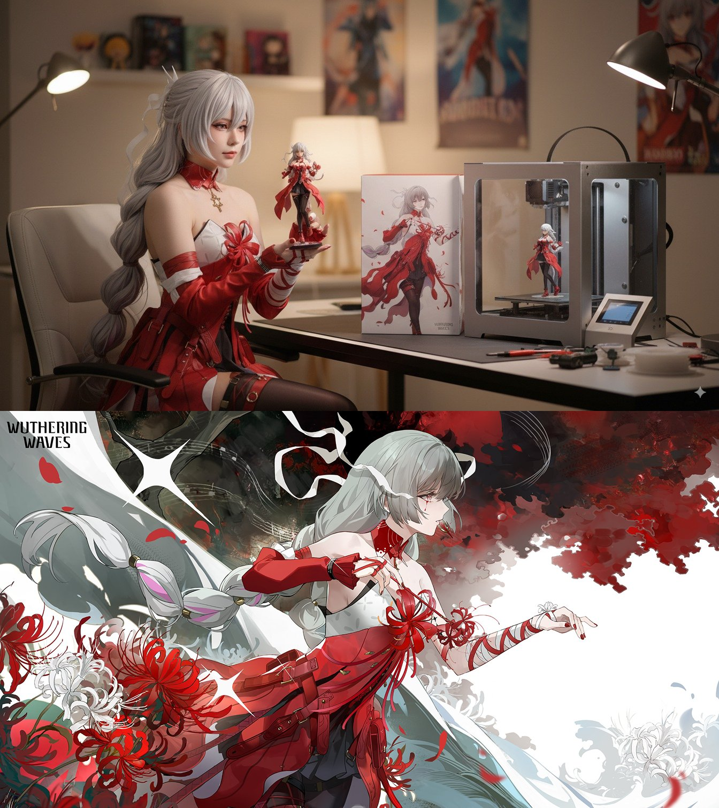
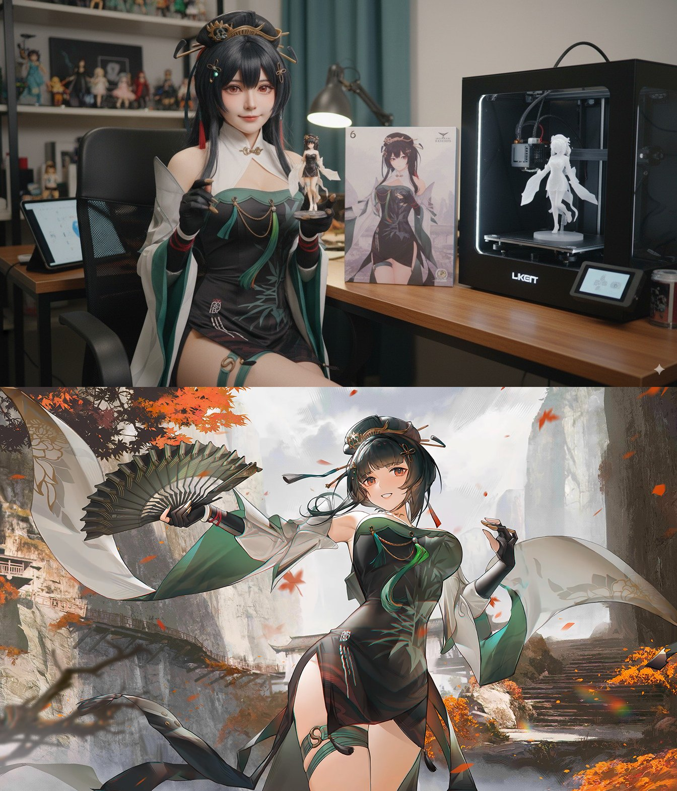

## 真人 Coser 展示手办

### 概述

最火的两大Nano Banana玩法叠加！

既然转手办很火、动漫转真人也很火，那动漫图转真人Cosplay 展示手办呢？
哈哈，优化了一下下午 Nano Banana 转手办的玩法，现在变成真人Coser在桌前展示自己刚打的手办。
其他装备类展示也可以这么玩，比如你展示自己的自行车手办。

来源：[X 原帖](https://x.com/op7418/status/1962150011560702097)

### 适配模型

- Nano Banana

### 示例






### 提示词

```
Generate a real-life photo of a cosplayer portraying this character, with highly realistic skin texture. The cosplayer's hairstyle, accessories, and clothing must match the character's.

She is sitting at a desk, holding a figurine transformed from this anime character's image. The figurine should be very close to the camera, with extremely detailed features. On the table behind the cosplayer, place a printed box of the character's figurine. 

Add a high-end 3D printer next to it, with a figurine being printed inside the printer. Set the entire scene in an indoor environment.
```
