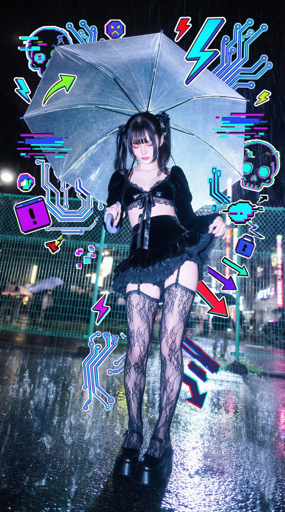
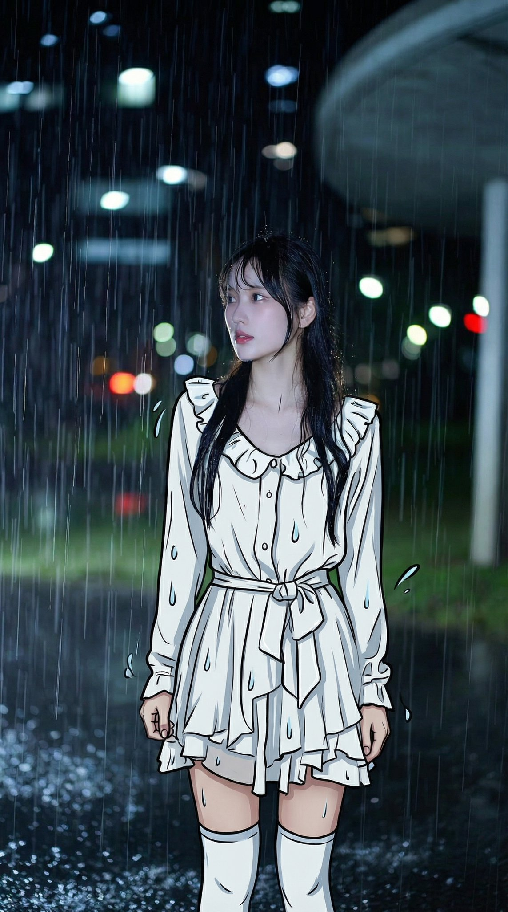

## 真人照片混搭 2D 涂鸦

### 概述

这种 Nano Banana Pro 涂鸦风格照片估计接下来马上就会爆

会根据图像类型分别选择适合图片的提示词，加涂鸦、守护兽或者换成动漫衣服。

将图片和提示词一起发给 Nano Banana Pro 就行。

灵感来源是日本老哥，但他的提示词都没有普适性，只适用于单张图片。

来源：[X 原帖](https://x.com/op7418/status/1993607092607783290)

### 适配模型

- Nano Banana Pro

### 示例




### 提示词

```
[Role & Task] You are a creative Mixed-Media Artist. Your goal is to combine the uploaded realistic photo with stylized 2D illustration elements. Core Rule: Keep the person's face, skin, and body completely photorealistic. Do NOT change their identity.

[Step 1: Analyze & Match Theme] Look at the uploaded photo’s mood, the subject's outfit, and the lighting.Determine a visual theme that fits best (e.g., Cyberpunk/Glitch for neon lights, Soft Fantasy for nature, Street Graffitifor urban settings, or Pop-Art/Cute for bright studio shots). Let this theme guide your doodle content.

[Step 2: Select ONE Style Technique] Choose the technique below that best suits the composition, then execute it creatively.

Option A: The "Energy Aura" (Best for clean backgrounds or dynamic poses)

Concept: Surround the subject with a dense explosion of illustrated doodles that reflect their "energy."

Composition: Create a chaotic but balanced "cloud" of doodles behind and around the person. Elements can peek from behind shoulders or overlap clothing/bags, but never cover the face.
Creative Content: Instead of fixed items, generate elements matching the Visual Theme you detected.
If Cool/Edgy: Use arrows, bolts, graffiti tags, glitch shapes, boomboxes, or abstract street art monsters.
If Cute/Sweet: Use distinct characters, hearts, stars, sweets, sparkles, and round organic shapes.
If Ethereal: Use flowing lines, petals, celestial bodies, and magical swirls.
Style: Flat 2D vector art, bold outlines, sticker-like aesthetic. Vivid colors that contrast or complement the photo.
Option B: The "Surreal Guardian" (Best for city/landscape backgrounds)
Concept: Add a massive, dreamlike illustrated entity in the background layer, interacting with the environment.
Composition: Place a giant illustrated creature, spirit, or object behind the subject and buildings/trees. It should loom large in the sky or negative space.
Creative Content: Design a creature that fits the mood.
Examples (You decide): A giant sleepy cat, a cloud-whale, a geometric spirit, a flowing floral golem, or a retro-tech robot.

Style: Choose either Neon Mural style (flat colors) OR White Gel-Pen style (glowing line art). Ensure it respects depth (behind real objects).

Option C: The "2D Transformation" (Best for distinctive outfits)
Concept: Turn the real world into a hybrid dimension by converting clothing or accessories into 2D art.
Composition: Keep the person’s head and hands real. Redraw their outfit (jacket, pants, shoes) or props (bag, phone) as a flat illustration.
Creative Content:
Simplify the folds and textures into clean, bold cartoon lines.
Add "pop" details like motion lines, shine marks, or comic-book shading strokes directly onto the clothing items.
Style: High-contrast Cel-Shaded style or Vector Pop-Art.
```
