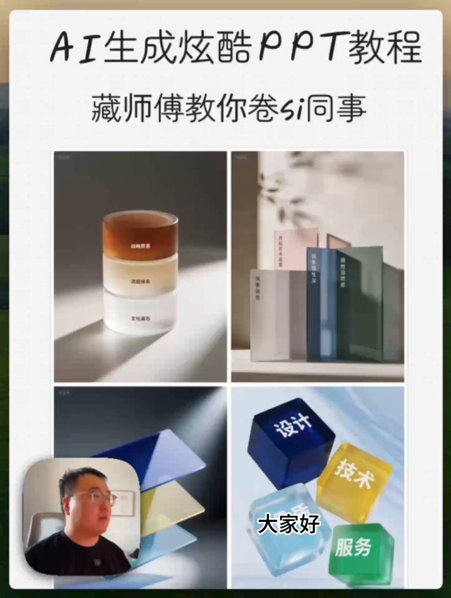

## 磨砂玻璃圆环 PPT 图表

### 概述

发一下这个即梦做的 PPT 图片的提示词和视频教程

有提示词结构和思考过程

来源：[X 原帖](https://x.com/op7418/status/1953093073715765693)

### 适配模型

- 即梦

### 示例

原帖为视频，下图为视频封面截图。



### 提示词

```
三个厚重的磨砂玻璃圆环垂直堆叠，构成一座坚实而庄重的塔柱。它们的尺寸由下至上逐级微缩，从底部的宽大稳固到顶部的精致收敛，形成一种稳定向上的视觉语言，象征着企业文化、流程与战略的层层构建。

最底层的圆环上是'文化基石'，中间是'流程体系'，顶层则是'战略愿景'。色彩也随着层级变化，从大地般的赤陶色向上过渡到天空般的暖白色，赋予了结构一种有机生长的感觉。

它们静立在浅灰色的极简空间里，仅有地面上一圈柔和的倒影，整体画面宁静而有力，传递出一种根基深厚、层层递进、稳步登高的企业哲学。
```
