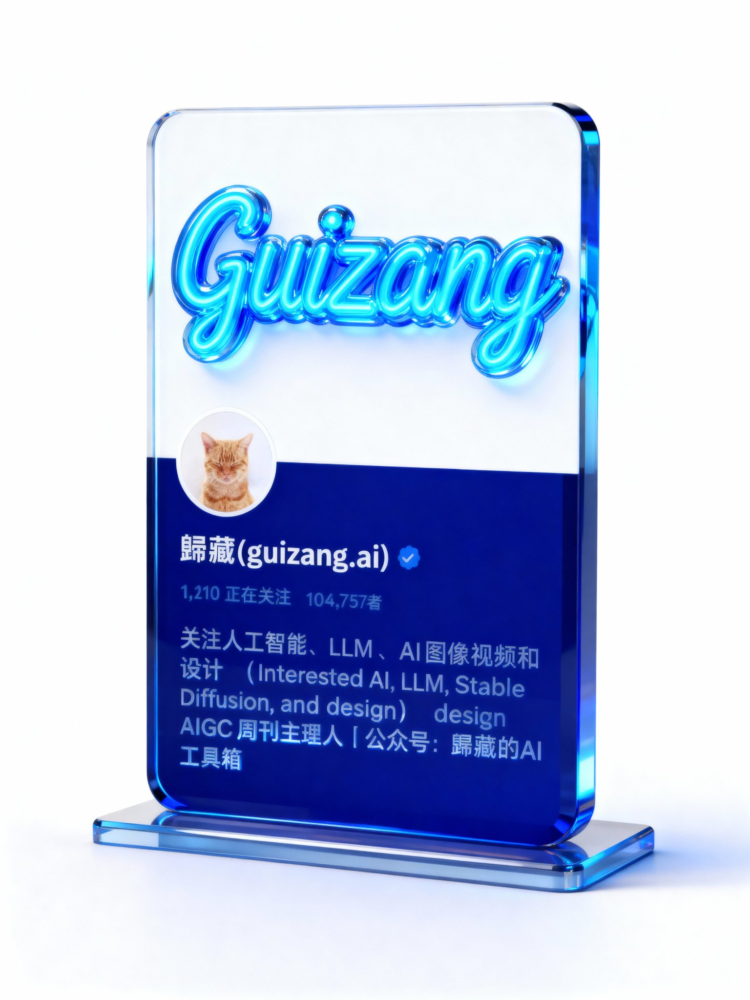

## 社交媒体信息展示卡片

来源：[X 原帖](https://x.com/op7418/status/1985377846534271236)

### 概述

将你的社交媒体截图和提示词一起发给模型。

### 适配模型

- Nano Banana Pro
- Seedream
- gpt-image

### 示例

### 提示词
一个 C4D 渲染的特写镜头，聚焦于一个手拿着的玻璃/亚克力卡片。

摆件被设计成简洁而现代的社交媒体信息展示牌。在摆件顶部，以荧光蓝手写艺术字的形式呈现一个醒目的装饰性词语“Guizang”，字体材质为高光泽的液态玻璃或霓虹灯管质感，散发着强烈的荧光蓝光芒，一部分突破摆件范围。摆件下方清晰地呈现出精简的社交媒体资料视图：一个圆形的用户头像、用户名、粉丝数量以及一段简洁的个人简介。这些信息以简洁的白色无衬线字体镌刻或以半透明的光效呈现在摆件深蓝色的主体板面上，形成一种干净、有序且具有科技感的排版风格，与顶部的手写字体形成对比。

3D艺术，C4D，磨砂玻璃质感，透明感，UI设计风格，光线追踪，干净深色背景，参考Pinterest、Dribbble 风格，使用OC渲染器，Blender渲染