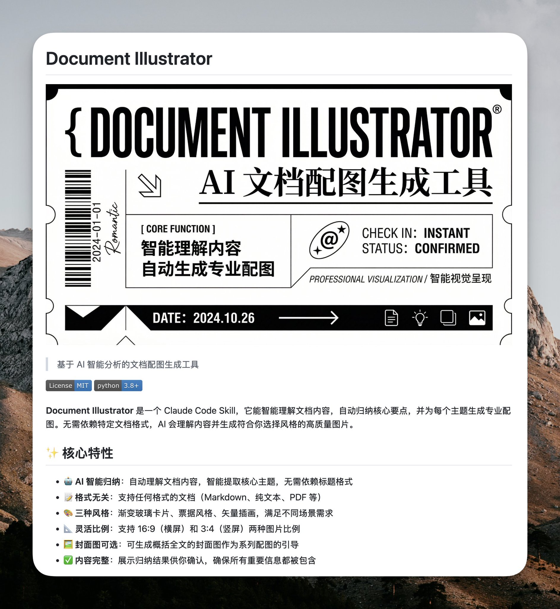

## 票据风封面海报

### 概述

大家问了一万遍的票据风格提示词。黑白对比、登机牌和门票那种票券化布局，中英混排加条形码这类商业元素，填上你的文案就能出一张高级杂志感的中文封面海报。

来源：[X 原帖](https://x.com/op7418/status/2013920609038893233)

### 适配模型

- Nano Banana Pro

### 示例



### 提示词

```
帮我根据下面的设计风格要求和内容要求，生成一张中文的封面海报，不要有大段文字：

设计风格要求：
运用3-4种不同字号创造层次感，关键词使用最大字号
主标题字号需要比副标题和介绍大三倍以上，采用网格排版，类似高级杂志
文字与装饰元素间保持和谐的比例关系
确保视觉流向清晰，引导读者目光移动
数字极简票券风设计风格
黑白对比主导：高度对比的黑白配色方案，形成强烈视觉冲击
票券化布局：类似登机牌、门票或电子凭证的结构设计
几何分区明确：画面被精确划分为信息区块，井然有序
留白艺术运用：大量有效留白提升整体通透感和优雅度
东西方美学融合：结合中文传统排版与西方现代设计语言
工业设计感：注册商标符号、条形码等商业元素的精致运用
数字界面映射：模拟电子屏幕或应用界面的信息呈现方式
文字排版风格
中英混排对比：中英文字体混合使用，创造文化融合感
尺寸层级分明：主标题大号处理，副文本精致小巧
多向排列组合：包含横排、竖排、斜排等多方向文字布局
间距精确控制：字符间距和行距经过精心计算，保持呼吸感
符号化装饰：括号、下划线、箭头融入文字设计
衬线与非衬线混搭：不同字体家族交替使用，增强层次感
时间信息格式化：日期标注采用统一格式，搭配方向指示符
视觉元素风格
功能性指示符：各类箭头、星号作为视觉引导和强调
UI元素借鉴："CHECK IN"、"@"等数字界面元素的平面化应用
边框与分割线：简洁线条用于区隔不同信息区域
简约图形符号：最小化的设计符号传达核心信息
手写风点缀：如"Romantic"的手写体为机械排版增添人文温度
方向性视觉流动：通过元素排布创造从左到右、从上到下的阅读节奏
负空间利用：将空白区域视为积极设计元素的一部分

文案内容为：[在这里填写你的文案或者标题]
```
