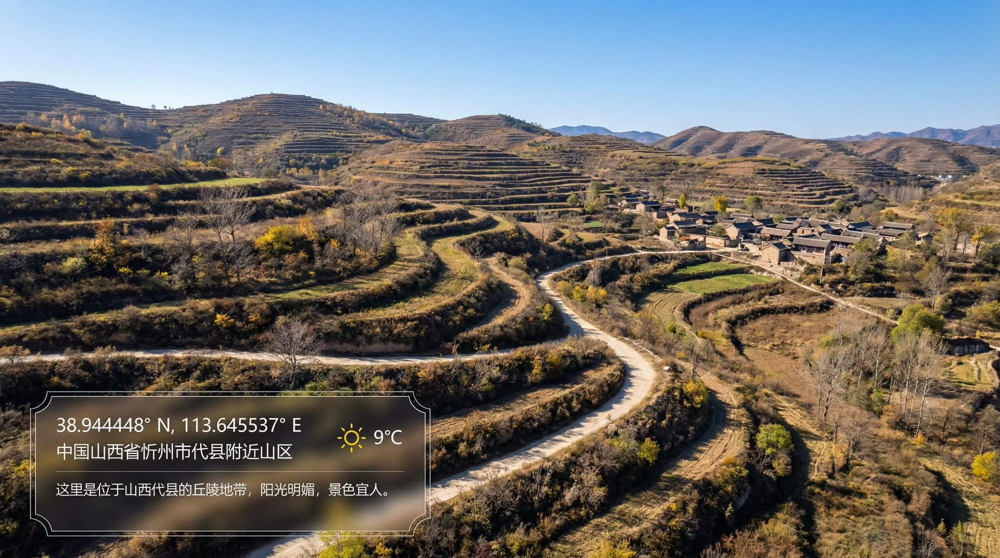
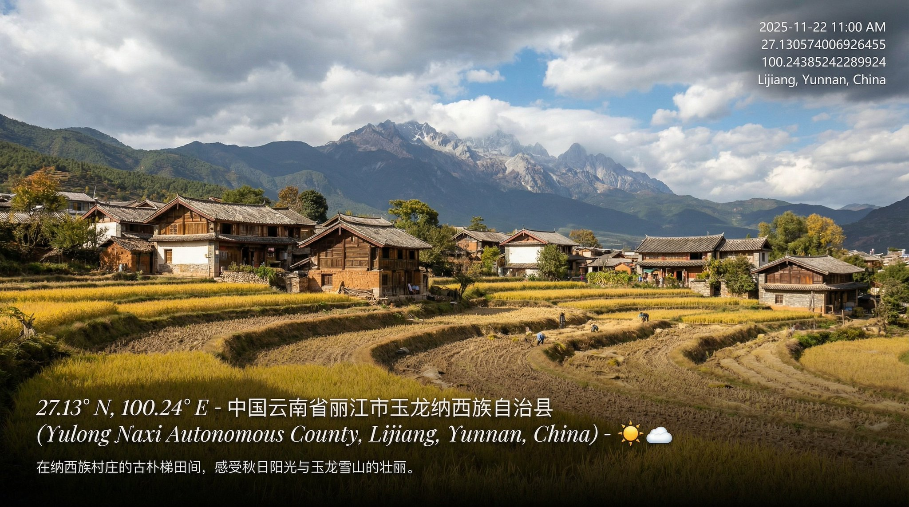
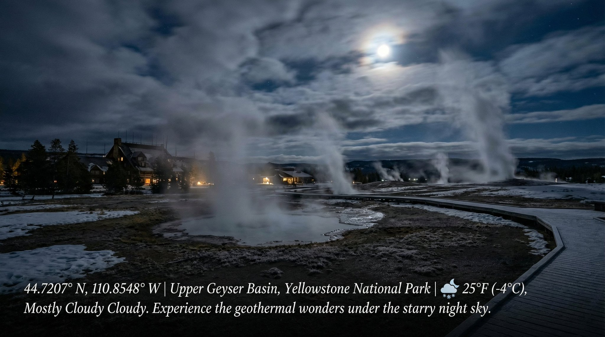

## 经纬度实时场景水印照片

### 概述

Nano Banana Pro 太顶了，我去，实时信息检索还能这么用！

给他一段经纬度，让他直接生成现在这个地方场景的图片，结合了当前的天气以及当地的时间

我看了一下，除了山西这个我选的是五台山，它漂移到了忻州以外，其他部分信息都是对的，我麻了

来源：[X 原帖](https://x.com/op7418/status/1992076009953489323)

### 适配模型

- Nano Banana Pro

### 示例






### 提示词

```
创建一幅经纬度位于40.00023661635351, 116.27808154448789并且符合当地当前时间氛围和实时天气的图像，在照片左下角用优美的排版写上当前经纬度以及位置信息和天气图标，并加上一句中文位置介绍文案。
```
