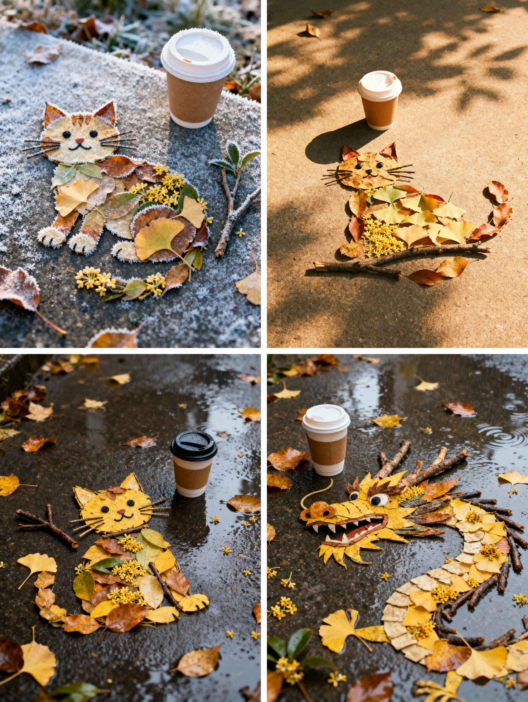

## 落叶拼图小猫

### 概述

秋天就适合玩树叶，好像小红书这个又火了，想不明白

不过模型居然组合的挺好，尤其第三张树叶、树枝和桂花摆放的很完美

下面👇有提示词

来源：[X 原帖](https://x.com/op7418/status/1967873876551233660)

### 适配模型

- 未注明（2025 年 9 月发布）

### 示例



### 提示词

```
提示词，也可以自己拍一张有树叶的地面让模型给你改图

中景，有阳光的午后，胶片质感，拍摄地面，秋天的落叶、树枝、银杏叶和桂花在平面上拼成了一个小猫的样子，旁边放着一杯一次性咖啡杯
```
