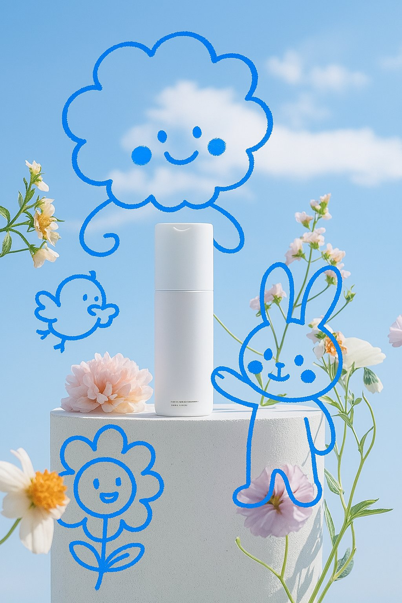

## 蓝色画笔互动涂鸦

### 概述

4o 这个玩法太可爱了，只涂鸦不写字也能避免文字问题

原作者没写提示词，

来源：[X 原帖](https://x.com/op7418/status/1907257214756348021)

### 适配模型

- GPT-4o

### 示例




### 提示词

```
用蓝色画笔画一些可爱的涂鸦与画面主体产生互动，可以是人物也可以是动物或者其他东西，生成 2:3 图片，笔触的质感强一些
```
