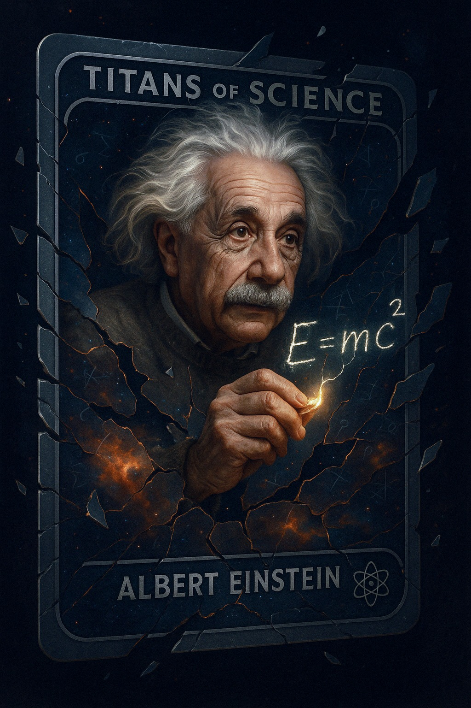
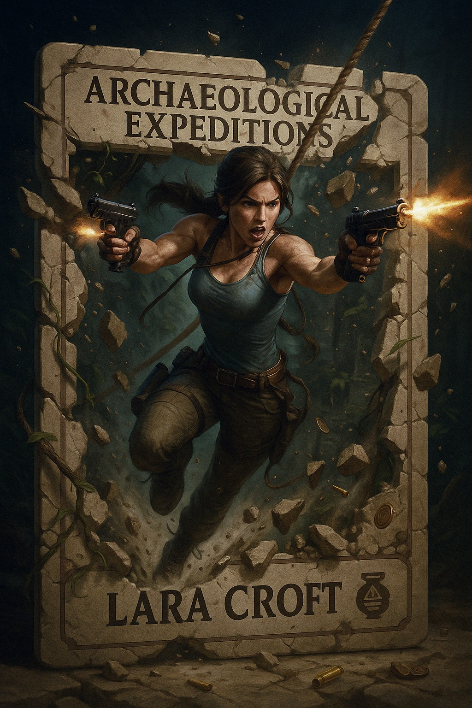

## 角色破框卡片

### 概述

这个好玩，用 4o 生成跟主角交互的物理破坏效果卡片

做了一下爱因斯坦和劳拉的卡片

dimensional break effects + motion depth 这两个词是核心

来源：[X 原帖](https://x.com/op7418/status/1912782048160542886)

### 适配模型

- GPT-4o

### 示例




### 提示词

```
一幅超写实、电影感的插画，描绘了劳拉·克劳馥动态地撞穿一张“考古探险”集换卡牌的边框。她正处于跳跃中或用绳索摆荡，穿着标志性的冒险装备，可能正在使用双枪射击，枪口的火焰帮助将卡牌古老的石雕边框震碎，在破口周围制造出可见的维度破裂效果，如能量裂纹和空间扭曲，使灰尘和碎片四散飞溅。她的身体充满活力地向前冲出，带有明显的运动深度，突破了卡牌的平面，卡牌内部（背景）描绘着茂密的丛林遗迹或布满陷阱的古墓内部。卡牌的碎屑与 crumbling 的石头、飞舞的藤蔓、古钱币碎片和用过的弹壳混合在一起。“考古探险”的标题和“劳拉·克劳馥”的名字（带有一个风格化的文物图标）在卡牌剩余的、布满裂纹和风化痕迹的部分上可见。充满冒险感的、动态的灯光突出了她的运动能力和危险的环境。
```
