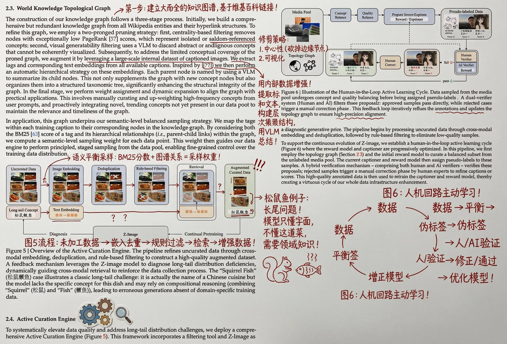

## 论文红墨水涂鸦批注

### 概述

可以让 Nano Banana Pro 帮你用涂鸦批注论文！

我居然真能理解了

来源：[X 原帖](https://x.com/op7418/status/1998073768472895778)

### 适配模型

- Nano Banana Pro

### 示例



### 提示词

```
把它打印出来，然后用红墨水疯狂地加上手写中文批注、涂鸦、乱画，还可以加点小剪贴画，主要内容就是用中文的批注帮助一个大学知识水平的人了解这部分论文的原理和细节
```
