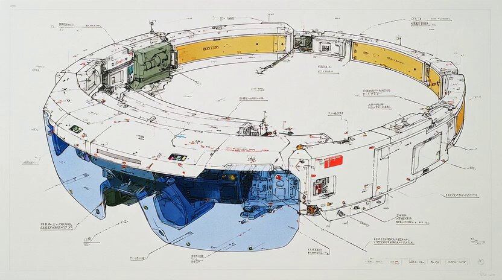
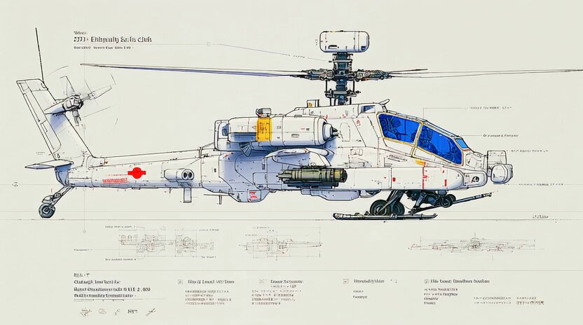
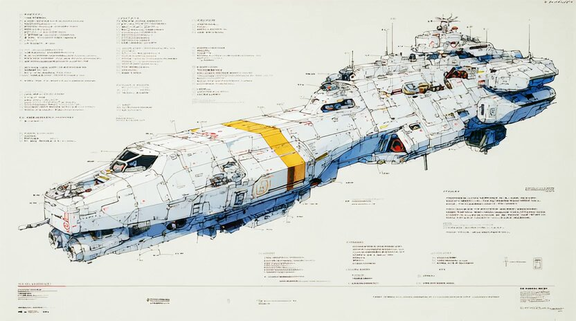
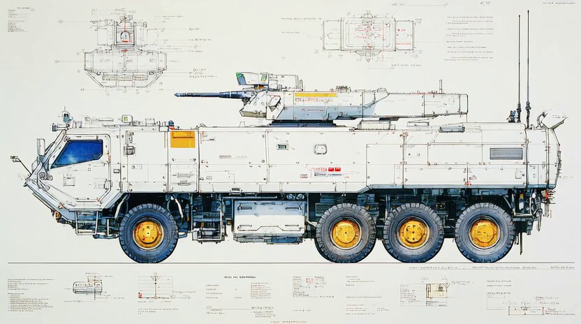

## 近未来武器蓝图草图

### 概述

画了一些近未来高科技武器草图展示

来源：[X 原帖](https://x.com/op7418/status/1942849852850987213)

### 适配模型

- Midjourney（搭配风格代码）

### 示例

原帖为视频，下图为视频封面截图。






### 提示词

```
无人潜航母舰 (Unmanned Submersible Drone Carrier)

中文版: 未来无人潜航母舰的蓝图风格概念草图，预计15-20年后的设计。图像为高度详细的手绘工业设计图，采用黑色墨水轮廓和石墨阴影绘制，布局于干净的白色素描纸上。潜航器采用仿生学设计，拥有量子通信阵列、用于释放无人机群的电磁弹射系统和先进的声学隐形涂层，设计用于深海区域拒止和秘密情报、监视与侦察任务。

English Version: A blueprint-style concept sketch of a future unmanned submersible drone carrier, projected 15-20 years from now. The image is a highly detailed hand-drawn industrial design drawing, rendered with black ink outlines and graphite shading on clean white sketch paper. The submersible features a biomimetic design, a quantum communication array, an electromagnetic launch system for deploying drone swarms, and an advanced acoustic stealth coating, designed for deep-sea area denial and clandestine intelligence, surveillance, and reconnaissance (ISR) missions.
```
