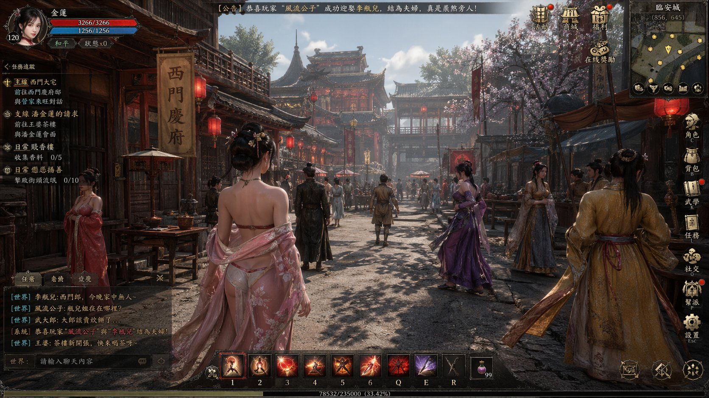

## 《金瓶梅》ARPG 游戏截图

### 概述

一句话让 GPT-Image-2 生成一个以《金瓶梅》为主题的古代 ARPG MMO 开放世界游戏截图，尺度有点大。题材换成你想要的小说或者朝代就行。

来源：[X 原帖](https://x.com/op7418/status/2046520509651886451)

### 适配模型

- GPT-Image-2

### 示例

### 提示词

帮我生成一个以《金瓶梅》为主题的古代 ARPG MMO 开放世界游戏的截图
