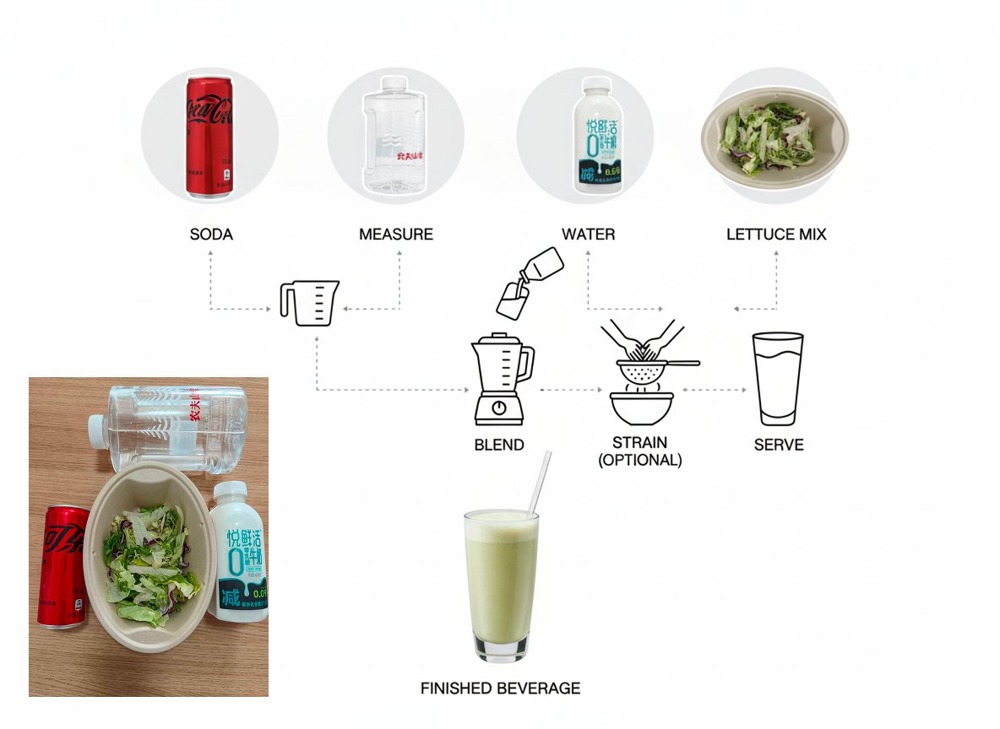
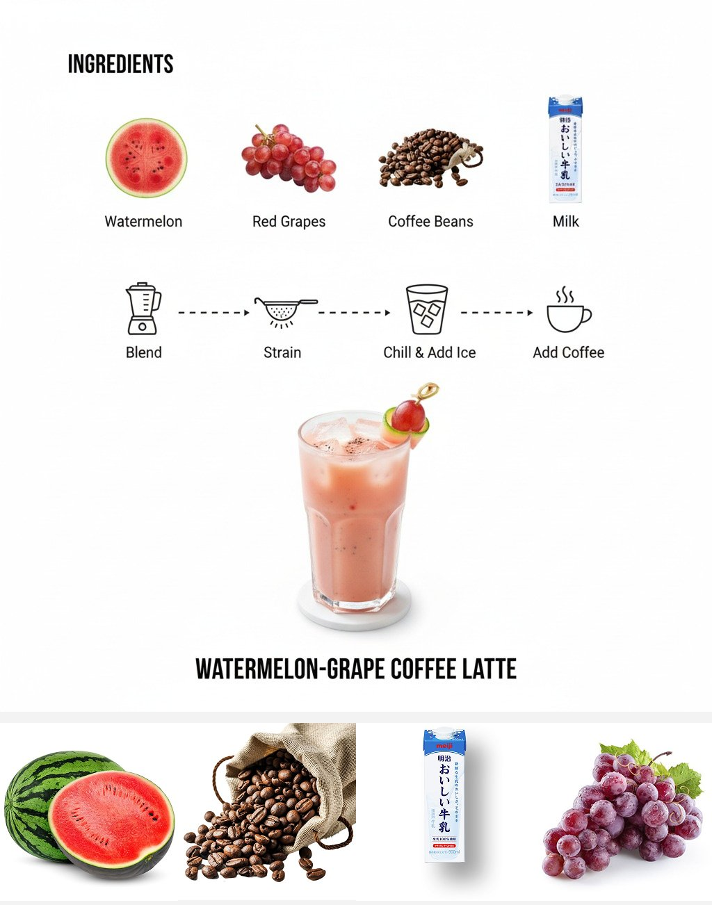

## 随手拍食材生成饮品食谱

### 概述

哈哈，不止可以做饭

Nana Banana 还能随手拍教你做奇葩饮品

把你家里看起来能做的喝的的东西拍给 Nano Banana 他就会帮你生成一个饮品制作食谱

来源：[X 原帖](https://x.com/op7418/status/1961677971670098337)

### 适配模型

- Nano Banana

### 示例




### 提示词

```
Create a complete step-by-step beverage infographic using the ingredients from the image, presented from a top-down perspective. 

Use a minimalist style with a white background. Include labeled photos of the ingredients, connect icons representing preparation steps with dashed lines, and display a photo of the finished beverage at the bottom of the infographic. Design a suitable container for the beverage. Additionally, remove the backgrounds from the food images and place the food on a white background.
```
