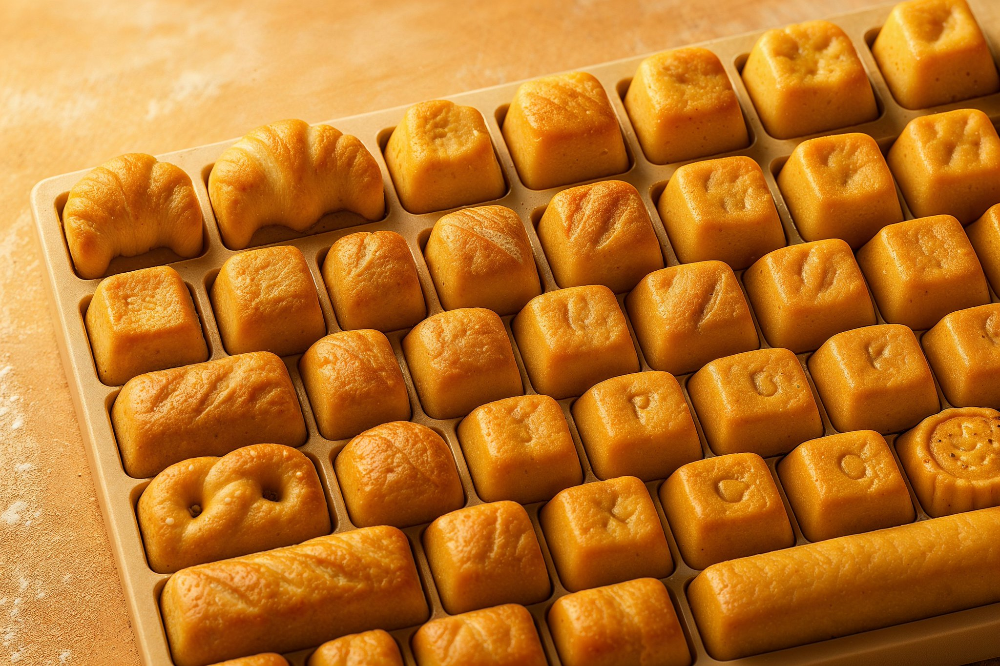
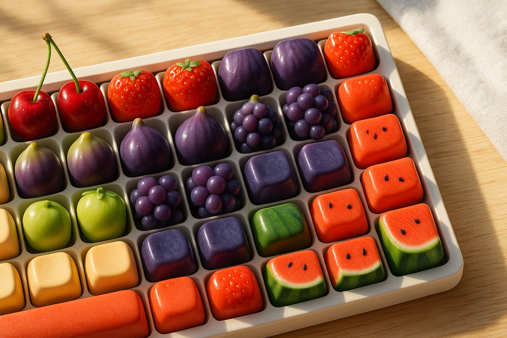
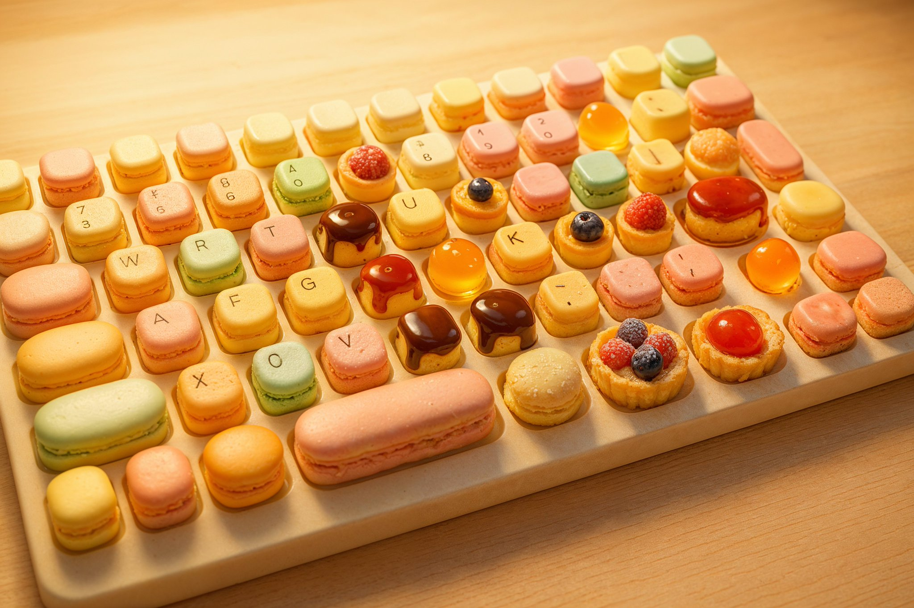
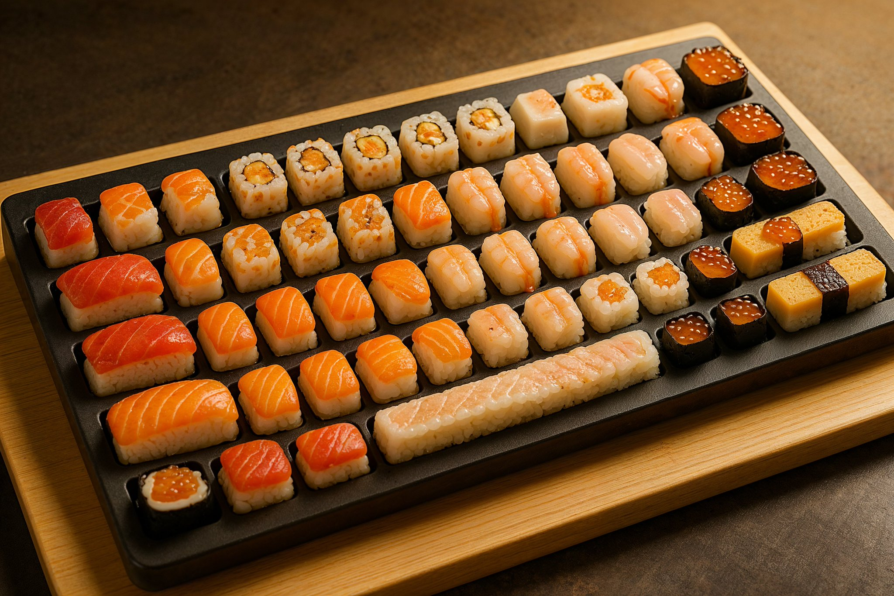

## 食品键盘

### 概述

最近 4o 的键盘玩法还在继续爆火

我自己又发散了一个新的食品键盘系列，马卡龙和面包烘焙这个看着太有食欲了

来源：[X 原帖](https://x.com/op7418/status/1927339781932900856)

### 适配模型

- GPT-4o

### 示例






### 提示词

```
帮我生成一张 3:2 比例的图片，一个超现实风格的键盘，每个按键都是一件微缩的匠心烘焙制品——例如一个拥有完美分层的小牛角包、一块有着酥脆外壳的乡村面包、一个点缀着海盐的迷你椒盐卷饼、或是一份精致的咸派——设计上突出烘焙品的金黄光泽、酥松或扎实的口感纹理。整个场景采用温暖、明亮的烘焙坊灯光。高调光照，阴影柔和，置于撒了少许面粉的木质操作台或大理石板上，键盘键帽布局和大小要跟真实键盘一致。
```
