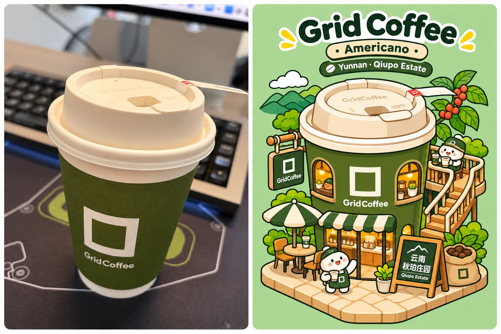

## 饮品照片 → 等轴测微缩建筑插画

### 概述

把你的咖啡、奶茶或饮料照片，变成一座由杯子改造成的可爱品牌主题微缩门店插画。告诉它咖啡名称和咖啡豆产地，它还会把产地风味元素加进场景里。最后用代码把原图和插画拼成一张对比图。

来源：[X 原帖](https://x.com/op7418/status/2117597892756312271)

### 适配模型

- GPT Image 2.0

### 示例

### 提示词

请根据我上传的真实饮品照片，将照片中的咖啡、奶茶或饮料改造成一座可爱的品牌主题微缩建筑，使用粗黑描边的 2D 等轴测扁平矢量插画风格。

最后将原始照片和生成的插画通过代码拼接，输出一张完整的高清对比图。

用户提供的信息

品牌名称：【选填，留空则从照片自动识别】
饮品名称：【选填，留空则从照片自动识别】
联名信息：【选填，没有则忽略】
其他特色：【选填，例如咖啡豆产地、庄园名称、特殊配料等】
用户默认会上传一张饮品照片。优先识别照片中的品牌 Logo、包装、颜色、杯型、文字和饮品特色。
如果用户提供了明确的信息，以用户填写的内容为准；无法确认的信息不要自行编造。
原图参考与轮廓保真（最高优先级）

必须直接将用户上传的真实照片作为图像生成的视觉参考，进行图生图创作，而不是只根据文字描述重新设计一个杯子。

请让图像模型直接观察并理解原图的主体轮廓，不需要使用代码预先提取边缘或生成线稿。

重点保留：

杯型轮廓： 杯身的宽高比例、上宽下窄的形态、瓶身或罐身的独特造型。
顶部结构： 杯盖厚度、杯口轮廓、吸管位置、奶盖、奶油等。
包装特征： 品牌 Logo、主色、标签位置、特殊图案、文字布局。
饮品细节： 液体颜色、分层、冰块、珍珠、水果、咖啡豆、饼干碎等。
独特标识： 联名人物、吉祥物、特殊贴纸和装饰。

以原图的杯身轮廓为基础进行插画化和建筑化改造，让生成的建筑依然能够一眼看出是照片中的那杯饮料。

不要随意替换杯型、改变品牌配色或重新设计包装。

但也不要机械复制原照片的拍摄角度，需要在保留原始造型的同时进行合理的三维空间推演。
核心原则：保留原始饮品的识别特征，重新设计它的建筑功能。
等轴测微缩建筑设计
将饮品包装改造成一座充满童趣的品牌主题微缩建筑（Isometric Miniature Diorama）。
采用 Elevated Three-Quarter Isometric View，从建筑斜前方约 45°、向下约 30° 的角度观察。

必须能清楚看到建筑顶部、正面、侧面和地台的空间纵深，不能使用完全正面的产品展示视角。

建筑设计要求：

将原始杯身作为建筑主体，保留其形状和标志性包装特征。
将杯盖、奶盖、饮品配料等自然转化为屋顶、平台、露台或趣味建筑装饰。
在杯身上设计圆形窗户、入口、商店橱窗、阳台等。
根据空间结构增加楼梯、蓝色滑梯、观景台、遮阳棚、悬挂招牌等设施。
加入可爱的卡通吉祥物，让它们在建筑里喝饮料、玩耍、滑滑梯、向窗外张望。
周围搭配盆栽、藤蔓、花朵、草坪等绿植，营造治愈的微缩景观。
根据饮品特色增加相关元素，例如咖啡树、咖啡果实、饼干、橙子、茶叶、珍珠等。
如果有特殊产地、庄园或联名信息，可将相关视觉元素融入周围环境。

所有装饰都要围绕品牌和饮品特色展开，不要每次机械地复制同一种建筑布局。

整座建筑坐落于具有明确等轴测透视的斜向地台上，空间结构合理、层次丰富。

插画风格（严格遵守）

Bold Outline Isometric Flat Vector Illustration

采用专业的 2D 等轴测扁平矢量插画风格，而不是 3D 卡通渲染。

描边：
使用清晰、均匀、较粗的黑色轮廓线（Thick Consistent Black Outlines）。外轮廓略粗，内部细节略细，转角圆润，线条流畅。
色彩：
使用高纯度、干净、明快的纯色色块填充（Solid Flat Color Fills）。大面积平涂，每个物体仅使用少量相邻色阶表现结构。

阴影：
只允许少量边界清晰的硬边阴影（Minimal Hard-Edged Flat Shading），不使用明显渐变、真实反射和复杂光照。
造型：
几何形状简洁圆润，比例可爱，带有童趣和玩具化特点，但保持纯二维矢量插画质感。
背景：
使用明亮、柔和的薄荷绿或与品牌主色协调的纯净背景。可以添加少量白云、星星、植物等平面装饰。
整体品质：
精致的商业品牌 IP 插画海报，画面干净，色彩协调，空间关系清晰，细节丰富但不过度复杂。
画面应当像专业设计师使用 Adobe Illustrator 制作的矢量插画，而不是 Blender 或 Cinema 4D 渲染的三维场景。
严格避免：
3D Rendering、Photorealistic、Plastic Texture、Glossy Highlights、Soft Gradients、Realistic Lighting、Complex Shadows、Metallic Reflections、Painterly Texture、Watercolor、Oil Painting。
文字与标题排版
在插画顶部设计完整的品牌英文标题。
主标题： 品牌英文名称，例如 GRID COFFEE、ChaBaiDao、FANTA。
副标题： 饮品英文名称，例如 Americano、Caramel Cookie Latte。
补充信息： 如果存在联名、咖啡豆庄园、特殊产地等，可以加入一行较小的英文说明。
文字要求：
使用圆润、厚实的粗体无衬线字体（Rounded Bold Sans-serif）。
使用纯色文字，可以搭配简洁的白色描边。

不要使用立体挤压、浮雕、金属、渐变等复杂文字效果。

品牌主标题突出，副标题清晰，但不能喧宾夺主。

标题距离画面顶部至少保留约 8% 的安全边距。

标题与建筑之间保持舒适的留白，不要让文字贴着杯盖。

画面比例与构图

必须先生成一张独立、完整的插画，而不是让 AI 直接生成左右拼接的对比图。
根据原照片方向选择画布：
原图为竖版：生成 3:4 竖版插画。
原图为横版：生成 4:3 横版插画。
原图为正方形：生成 1:1 插画。
特殊比例可根据实际情况灵活适配。
构图要求：
所有建筑、楼梯、滑梯、人物、植物和底座必须完整出现在画面中。
主体距离画布左右和底部边缘保留约 6%–8% 的安全距离。

顶部文字与画布边缘留出足够空间。
不能截断任何重要建筑结构或装饰。
不要为了填满画面而过度放大主体。
不要因为满足比例要求而拉伸、压扁或裁切内容。
生成前就应规划完整构图，而不是完成后再强制裁切为目标比例。
使用代码自动拼接
独立插画完成后，再使用 Python Pillow 等工具进行图片拼接。
拼接规则：
原始照片为竖版：原图在左，插画在右。
原始照片为横版：原图在上，插画在下。
原始照片为正方形：默认左右拼接。

拼接要求：
必须使用用户上传的真实原始照片。
不得使用 AI 重新绘制的照片替换原图。
不裁切、不拉伸、不修改原照片的内容。

采用等比例缩放，使两张图片自然对齐。
如果宽高比例有差异，使用背景留白适配，而不是强行裁切。
两张图片之间可以添加适当的白色间隔。
保持插画完整，所有标题和建筑元素不得超出边界。
输出高清 PNG 图片。
8. 最终输出
直接完成整套创作流程，无需逐步征求用户确认。
提供两份成品：
① 完整独立插画 PNG
一张真正完整的等轴测微缩建筑插画，不是从左右对比图中裁切出来的图片。
② 原始照片 + 插画拼接 PNG
使用真实原始照片与生成插画，通过代码合成为一张完整图片。

最终优先展示拼接图，并提供两个高清图片文件。
最重要的执行原则：

原图直接作为视觉参考 → 保留原始杯型和包装轮廓 → 转换为斜上方 3/4 等轴测建筑 → 粗黑描边、纯色平涂的矢量风格 → 生成完整独立插画 → 使用代码与真实原图无裁切拼接。
最终效果应该让人一眼认出原本的那杯饮料，同时惊喜地发现它变成了一座精致、可爱、充满生活气息的微缩建筑。
