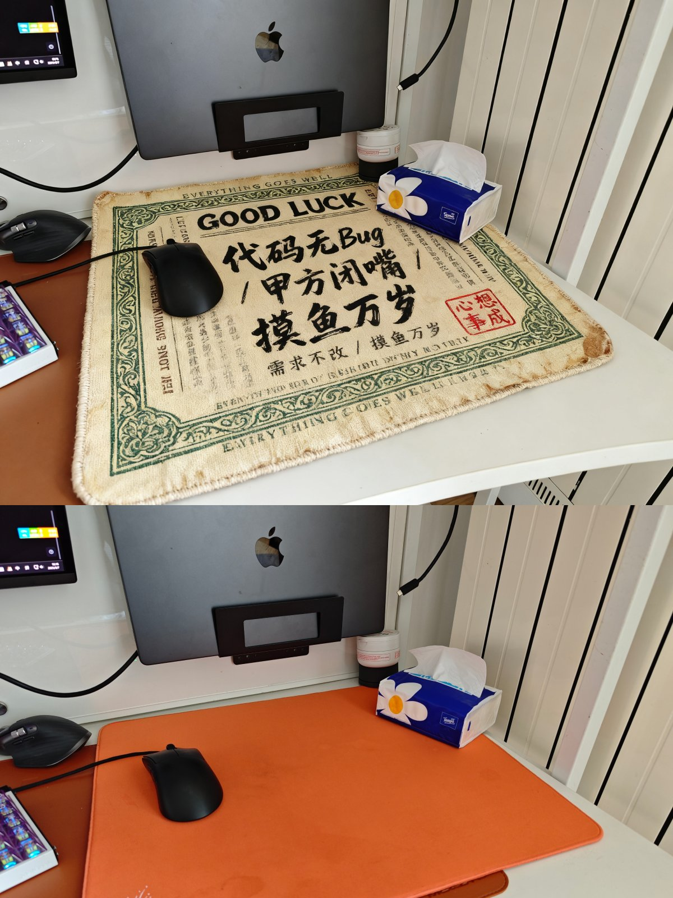

## 鼠标垫变国潮护身符

### 概述

哈哈  Seedream 4 生成图片的融合度太顶了。

我把自己的鼠标垫变成许愿符风格了。

来源：[X 原帖](https://x.com/op7418/status/1964607331154690260)

### 适配模型

- Seedream 4.0

### 示例



### 提示词

```
请将图片中涂抹的区域，替换成一个全新的、超写实风格的布艺鼠标垫。

鼠标垫设计要求：
设计主题： 鼠标垫的整个表面，需要完美地印刷上一个国潮护身符票据的图案。
图案细节： 这个票据图案以复古米黄为底色，外圈有复杂的绿色花纹边框。顶部和底部是重复的英文 'EVERYTHING GOES WELL'，中间有大写的 'GOOD LUCK'，两侧是竖排的 'LIFE IS SHORT WHY NOT TRY'。
核心祝福语： 在鼠标垫正中央，用极其粗犷、充满力量感的黑色书法狂草写着"代码无Bug / 甲方闭嘴 / 需求不改 / 摸鱼万岁"。

辅助元素： 祝福语周围簇拥着许多竖排的、模糊不清的祈福小字。在图案的右下角，有一个非常清晰、显眼的红色篆刻印章，印章内容可以是“心想事成”或类似的吉利话。

纸张质感： 尽管是印刷图案，但要表现出原始设计的纸张纹理，以及纸张边缘自然的粗糙磨损感。

与环境融合要求 ( realism is key! )：
完美替换： 新生成的鼠标垫必须完全遵循原始鼠标垫的形状、大小和透视角度，无缝地融入到照片环境中。
材质表现： 鼠标垫的材质应为高品质的细纤维布面，在图案上能看到极其微妙的布料纹理，边缘最好有精密的锁边设计。

光影一致： 必须严格遵守原照片的光照环境。台灯或屏幕的光照要自然地洒在鼠标垫表面，键盘、鼠标或其他桌上物品投射在鼠标垫上的阴影，要被完整且逼真地保留下来。

无缝衔接： 如果原始鼠标垫有部分被键盘、水杯等物品压住，生成的新鼠标垫图案也必须自然地出现在这些物品的下方，不能有任何穿帮或覆盖的痕迹。
```
